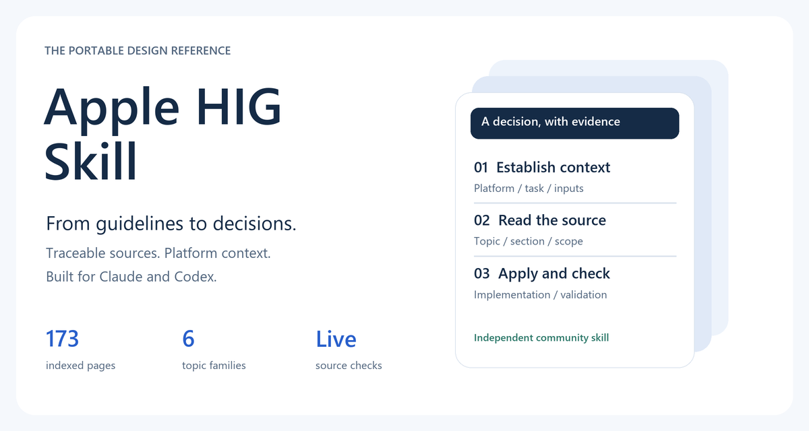
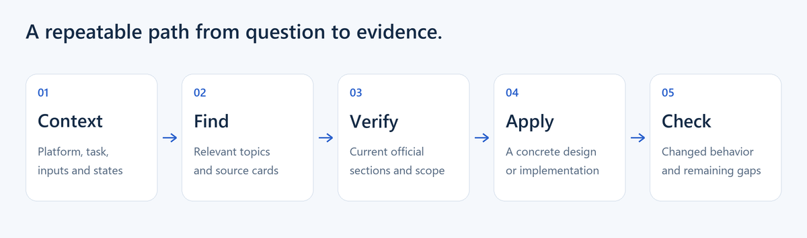

<p align="center"></p>

# Apple HIG Skill

**Bring Apple's Human Interface Guidelines into Claude and Codex.**

A portable Agent Skill for designing, implementing, and reviewing interfaces with traceable Apple sources. It includes concise guidance for **173 indexed pages**, platform-aware lookup, and tools for checking the current official documentation.

[Download the skill ZIP](https://github.com/fareslaggoun7/apple-hig-skill/raw/refs/heads/main/dist/apple-hig.zip) · [Installation](docs/INSTALLATION.md) · [Examples](examples/README.md) · [Coverage](docs/COVERAGE.md)


## Start here

| You use | Install | First prompt |
| --- | --- | --- |
| Claude.ai / Claude Desktop chat | [Download the ZIP](https://github.com/fareslaggoun7/apple-hig-skill/raw/refs/heads/main/dist/apple-hig.zip), then upload it in **Customize → Skills → + → Create skill → Upload a skill** and enable it | `Use the apple-hig skill to review this iPad interface.` |
| Claude Code | Clone this repo, then `python tools/install.py --target claude-code` | `/apple-hig Review this interface for macOS.` |
| Codex | Clone this repo, then `python tools/install.py --target codex` | `$apple-hig Review this interface for iOS.` |

Claude's upload flow is documented in [Use skills in Claude](https://support.claude.com/en/articles/12512180-use-skills-in-claude). Organization controls may affect availability. Read [the installation guide](docs/INSTALLATION.md) for prerequisites and other paths.

```sh
git clone https://github.com/fareslaggoun7/apple-hig-skill.git
cd apple-hig-skill
python tools/install.py --target claude-code
```

On macOS/Linux, use `python3` if `python` is unavailable. The installed skill and its helper use Python's standard library; no API key is required. Python is needed for helper commands, while the Markdown guidance can also be read directly.

## What you get

- Six reference collections: getting started, foundations, patterns, components, inputs, and technologies.
- Source URLs, section anchors, platform metadata, and fingerprints for every indexed page.
- Offline topic cards plus live official-source retrieval and drift detection.
- Examples of design reviews, platform decisions, and a runnable web adaptation.
- An installer that preserves existing skills, reproducible ZIP packaging, and automated checks.



## Try it

```text
Use the apple-hig skill to review this iPad document editor.
Check navigation, keyboard use, resizable windows, and text expansion.
For each finding, cite the applicable Apple section and explain the user impact.
```

Or explore without an assistant:

```sh
python skills/apple-hig/scripts/hig.py search "navigation" --platform ipados
python skills/apple-hig/scripts/hig.py show sidebars
python skills/apple-hig/scripts/hig.py fetch sidebars --outline
python skills/apple-hig/scripts/hig.py fetch sidebars --section Best-practices
```

Find [six prompt examples](examples/prompts.md), [worked reviews](examples/review-walkthrough.md), and [the interactive web demo](examples/web-adaptation/README.md).


## Coverage and honesty

The snapshot is dated **13 October 2026** and covers every page discovered in the recorded English HIG topic tree: **173/173**. This measures the page inventory, not exhaustive interpretation of every sentence or visual example. The summaries are selective; current official sections supply detail on demand.

**An error rate below 0.01% has not been established and is not guaranteed.** Source ambiguities, platform exceptions, and unverified image/video semantics are documented in [Coverage](docs/COVERAGE.md) and [the skill's evidence notes](skills/apple-hig/references/evidence-and-quality.md).

The skill's portable structure and commands are tested locally. A live installation in your Claude account, native Apple-device behavior, and model response quality require validation in your environment. Live retrieval depends on access to `developer.apple.com`; offline cards remain usable when networking is restricted.

## For contributors

```sh
python -m unittest discover -s tests -v
python tools/package.py
python skills/apple-hig/scripts/hig.py audit
```

See [Contributing](CONTRIBUTING.md), [Architecture](docs/ARCHITECTURE.md), [Usage](docs/USAGE.md), and [Releases](CHANGELOG.md). The helper is read-only against Apple's public documentation; `refresh` reports changes and does not silently rewrite authored guidance.

## License and attribution

Original project code, writing, and illustrations are provided under the [MIT license](LICENSE). Apple owns its documentation and trademarks; this project does not redistribute its articles or official artwork. This is an independent community project, not affiliated with or endorsed by Apple, Anthropic, or OpenAI. See [NOTICE](NOTICE).
