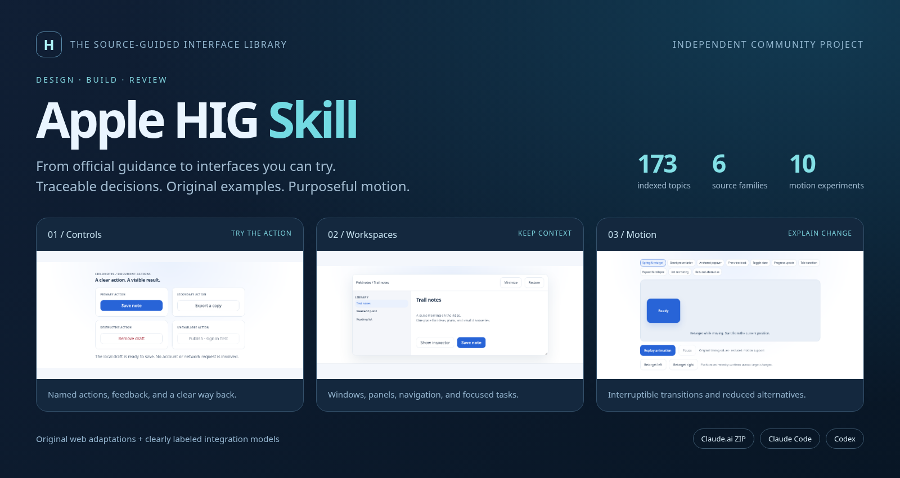
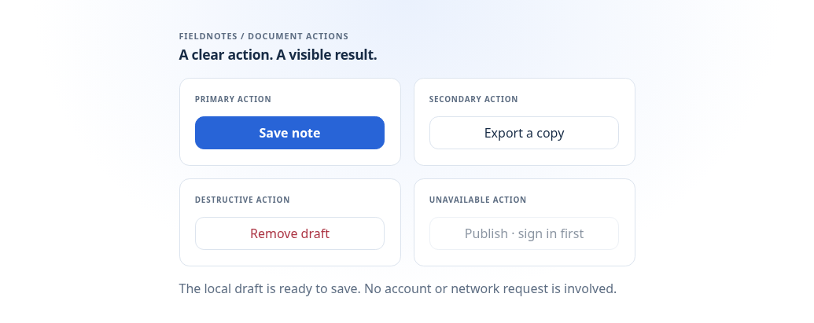
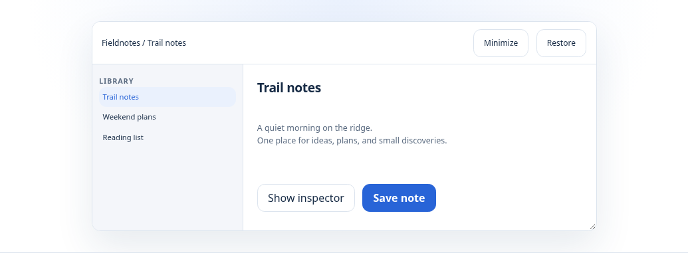
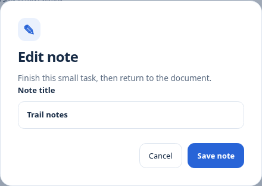
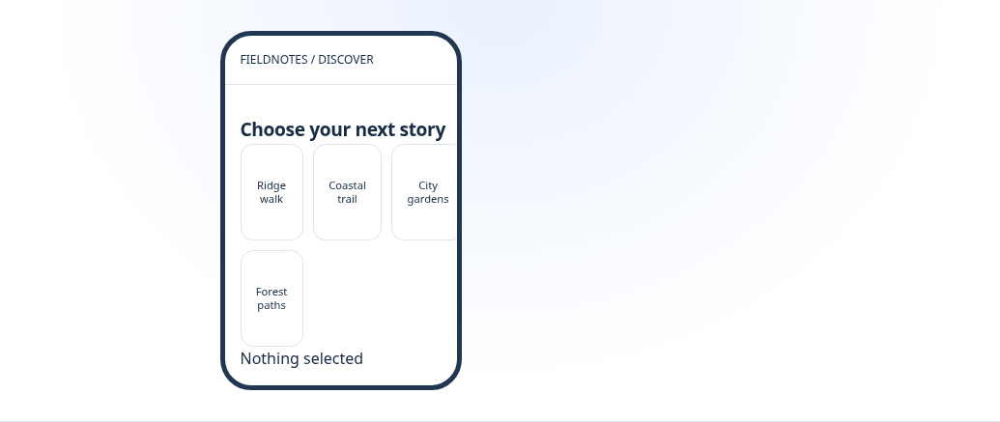
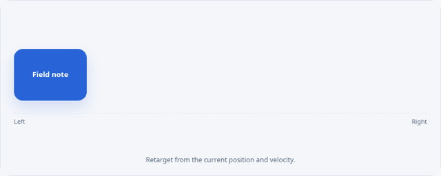
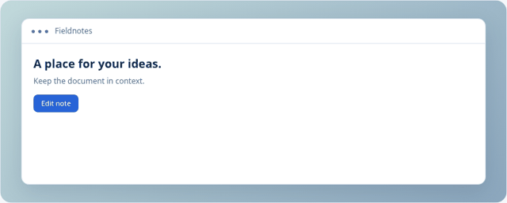
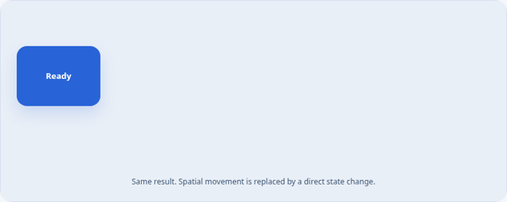

<p align="center"></p>

<p align="center">
  <a href="https://github.com/fareslaggoun7/apple-hig-skill/actions/workflows/validate.yml"></a>
  <a href="LICENSE"></a>
  <a href="https://github.com/fareslaggoun7/apple-hig-skill/releases/latest"></a>
  
</p>

<p align="center">
  <a href="docs/INSTALLATION.md"><strong>Install the skill</strong></a> ·
  <a href="https://github.com/fareslaggoun7/apple-hig-skill/releases/latest"><strong>Download ZIPs</strong></a> ·
  <a href="examples/gallery/README.md"><strong>Run the gallery</strong></a> ·
  <a href="examples/gallery/TOPICS.md"><strong>All 173 examples</strong></a> ·
  <a href="examples/gallery/MOTION.md"><strong>Motion lab</strong></a>
</p>

# Apple HIG Skill

**Bring Apple's Human Interface Guidelines into Claude and Codex—and try the decisions in a real browser.**

A portable Agent Skill for designing, implementing, and reviewing interfaces with traceable Apple sources. It combines **173 indexed topics**, concise platform-aware guidance, live official-source lookup, and an original interactive gallery. The gallery has a concrete task and a rendered picture for every topic, plus ten motion experiments with animated previews.

## Install once. Use in your client.

| Client | Install | First prompt |
| --- | --- | --- |
| Claude.ai / Claude Desktop chat | Download **apple-hig.zip** from [the latest release](https://github.com/fareslaggoun7/apple-hig-skill/releases/latest). Upload it in **Customize → Skills → + → Create skill → Upload a skill**, then enable it. | `Use the apple-hig skill to review this iPad interface.` |
| Claude Code | Clone this repository, then `python tools/install.py --target claude-code` | `/apple-hig Review this interface for macOS.` |
| Codex | Clone this repository, then `python tools/install.py --target codex` | `$apple-hig Review this interface for iOS.` |

```sh
git clone https://github.com/fareslaggoun7/apple-hig-skill.git
cd apple-hig-skill
python tools/install.py --target codex
```

Choose `claude-code` for Claude Code. On macOS/Linux, use `python3` if needed. The skill and helper use Python's standard library; no API key is required. Markdown guidance can be read without Python. [Installation details](docs/INSTALLATION.md) cover client prerequisites, custom paths, and safe updates. Claude's [documented skill upload flow](https://support.claude.com/en/articles/12512180-use-skills-in-claude) may be affected by account or organization controls.

## Interfaces you can actually try

The gallery includes working controls, screens, windows, real modal dialogs and sheets, navigation, forms, loading recovery, drawing, and drag interactions. It identifies simulated hardware, payments, accounts, and SDK integrations directly in the example. Those models do not invoke Apple services or make transactions.

<table>
  <tr>
    <td width="50%"><br><strong>Controls with explicit actions</strong></td>
    <td width="50%"><br><strong>Windows that preserve context</strong></td>
  </tr>
  <tr>
    <td><br><strong>Focused tasks with a clear exit</strong></td>
    <td><br><strong>Concrete screen examples</strong></td>
  </tr>
</table>

Run from the repository root:

```sh
python -m http.server 8000 --directory examples/gallery --bind 127.0.0.1
```

Enter `http://127.0.0.1:8000` in your browser. Search or choose a family; each route has a task, its Apple source, dated guidance, and scope. Use `?topic=buttons`, `?topic=sheets`, or `?topic=motion` to start directly. No build step, remote fonts, framework, or runtime packages are needed. The separate **apple-hig-gallery.zip** can also run after extraction.

[Gallery guide](examples/gallery/README.md) · [Exhaustive topic-to-example index and pictures](examples/gallery/TOPICS.md) · [Original small editor demo](examples/web-adaptation/README.md)

## Motion that explains a change

Replay, pause, interrupt, and compare a reduced alternative. The spring preserves its current position and velocity when you change its destination. The same renderers supply the recorded previews.

<table>
  <tr>
    <td width="50%"><br><strong>Continuous spring retargeting</strong></td>
    <td width="50%"><br><strong>Sheet presentation</strong></td>
  </tr>
  <tr>
    <td><br><strong>Visible state changes</strong></td>
    <td><br><strong>A stationary reduced alternative</strong></td>
  </tr>
</table>

[All ten motion experiments and previews](examples/gallery/MOTION.md) include popover origin, press feedback, progress, tabs, disclosure, and list reordering. Timings, easing, dimensions, and spring constants are original educational choices, not Apple specifications. Native animation fidelity and spatial comfort need testing on the target platform.

## From a source to a decision

```text
Use the apple-hig skill to review this iPad document editor.
Check navigation, keyboard use, resizable windows, and text expansion.
For each finding, cite the applicable Apple section and explain the user impact.
```

Or explore the sources directly:

```sh
python skills/apple-hig/scripts/hig.py search "navigation" --platform ipados
python skills/apple-hig/scripts/hig.py show sidebars
python skills/apple-hig/scripts/hig.py fetch sidebars --outline
python skills/apple-hig/scripts/hig.py fetch sidebars --section Best-practices
```

The six reference families cover getting started, foundations, patterns, components, inputs, and technologies. Each indexed page includes source URLs, section anchors, platform metadata, and fingerprints. Offline cards remain usable when live access to `developer.apple.com` is unavailable. `refresh` reports drift without silently rewriting guidance.

[Prompt library](examples/prompts.md) · [Worked reviews](examples/review-walkthrough.md) · [Usage](docs/USAGE.md) · [Architecture](docs/ARCHITECTURE.md)

## Coverage and evidence

The **13 October 2026** source snapshot covers all **173/173** pages discovered in the recorded English HIG topic tree. The gallery covers all 173 routes with 121 explicitly registered renderer kinds; related topics share appropriate controls while retaining their own task and source. Topic presence does not establish exhaustive interpretation of every sentence, accurate native geometry, or SDK conformance.

**A semantic error rate below 0.01% is unproven and is not guaranteed.** [Coverage](docs/COVERAGE.md) documents source ambiguities and unverified media semantics. Browser validation covers all routes at desktop and phone widths and representative keyboard, cancellation, validation, search, loading, and motion interactions. It does not establish full accessibility conformance, model response quality, Apple-device behavior, or a live installation in your Claude account.

## Contribute

```sh
python -m unittest discover -s tests -v
node --test tests/gallery.test.mjs
python tools/build_gallery_catalog.py --check
python skills/apple-hig/scripts/hig.py audit
python tools/package.py --check
python tools/package_gallery.py --check
```

[Contributing](CONTRIBUTING.md) explains source updates and distribution regeneration. [Gallery verification](examples/gallery/README.md#verification-and-regeneration) covers exhaustive browser checks, screenshots, and GIF generation. [Changelog](CHANGELOG.md) records releases.

## License and attribution

Original code, writing, and illustrations are [MIT licensed](LICENSE). Apple owns its documentation and trademarks; this project does not redistribute Apple articles or official artwork. This is an independent community project, with no affiliation with or endorsement by Apple, Anthropic, or OpenAI. See [NOTICE](NOTICE).
