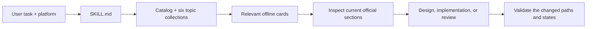
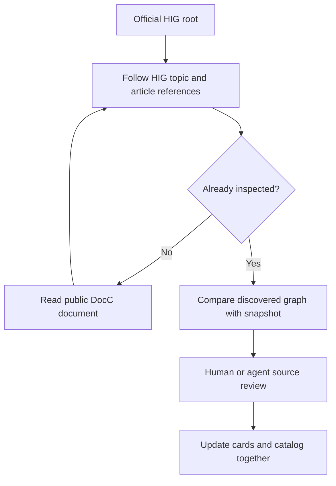

# Architecture

The installation is one portable Agent Skill. The repository adds documentation, examples, illustrations, tests, and packaging around it.



`skills/apple-hig/SKILL.md` contains the shared workflow. Reference files contain original topic summaries. `catalog.json` maps 173 pages to categories, source URLs, section anchors, platform tags, topic relationships, and fingerprints. The Python helper locates its own skill directory, so it works after the folder is copied.

Live retrieval reads Apple's public DocC JSON over HTTPS, within the HIG namespace. It preserves headings, tables, inline identifiers, tabs, and note context, and reports unfamiliar node types. It does not execute downloaded content. The full page bytes are not bundled as a copied documentation corpus.



`refresh` reports differences without overwriting authored guidance. Byte fingerprints and selected-payload fingerprints answer different questions; neither proves interpretation accuracy. Scope and source ambiguities are recorded in the skill's evidence reference.

## Repository map

```text
skills/apple-hig/   Installable skill: instructions, references, helper
docs/              Installation, usage, architecture, coverage, original images
examples/          Prompts, worked reviews, runnable web adaptation
tools/             Safe local installer, deterministic packaging, image builder
tests/             Offline portability and behavior checks
dist/              Ready-to-upload skill ZIP and SHA-256 checksum
.github/workflows/ Automated offline validation
```

The Markdown package is client-neutral. Codex's optional UI metadata is separate; Claude-specific configuration and model/API dependencies are unnecessary. No accounts or keys are required by the skill itself.
