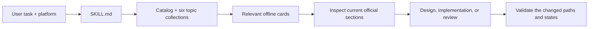
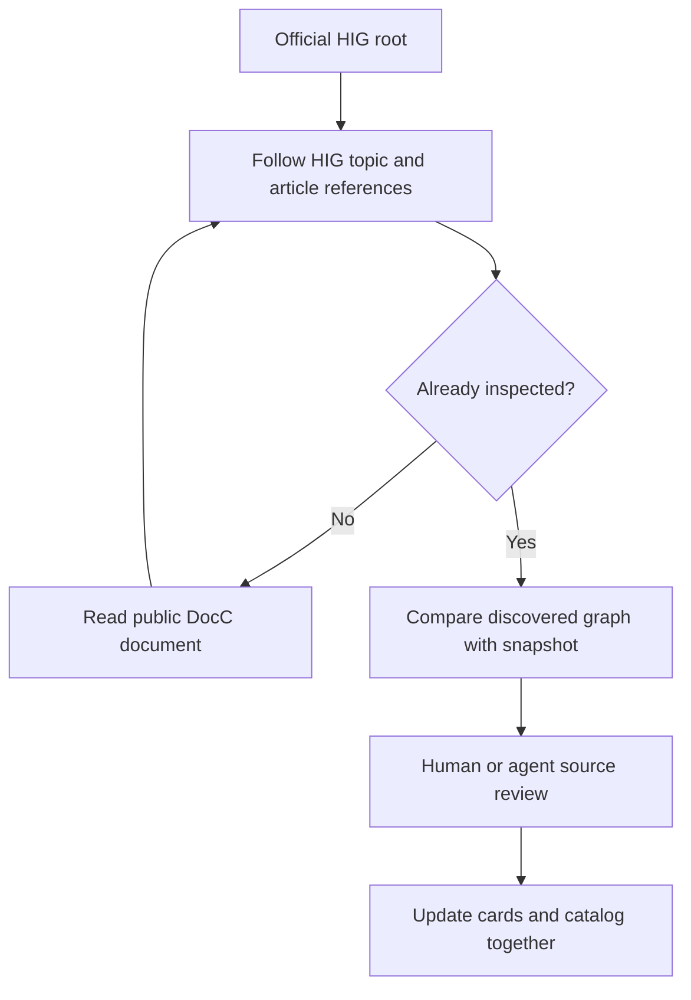

# Architecture

The installation is one portable Agent Skill. The repository adds documentation, examples, illustrations, tests, and packaging around it.



`skills/apple-hig/SKILL.md` contains the shared workflow. Reference files contain original topic summaries. `catalog.json` maps 173 pages to categories, source URLs, section anchors, platform tags, topic relationships, and fingerprints. The Python helper locates its own skill directory, so it works after the folder is copied.

Live retrieval reads Apple's public DocC JSON over HTTPS, within the HIG namespace. It preserves headings, tables, inline identifiers, tabs, and note context, and reports unfamiliar node types. It does not execute downloaded content. The full page bytes are not bundled as a copied documentation corpus.



`refresh` reports differences without overwriting authored guidance. Byte fingerprints and selected-payload fingerprints answer different questions; neither proves interpretation accuracy. Scope and source ambiguities are recorded in the skill's evidence reference.

## Repository map

```text
skills/apple-hig/   Installable skill: instructions, references, helper
docs/              Installation, usage, architecture, coverage, original images
examples/          Prompts, worked reviews, runnable gallery and web adaptation
tools/             Safe local installer, deterministic packaging, gallery catalog/capture tools, image builder
tests/             Python/Node package, catalog, and behavior checks
dist/              Portable skill and standalone gallery ZIPs with checksums
.github/workflows/ Cross-platform validation, browser QA, release, optional Pages
```

The Markdown package is client-neutral. Codex's optional UI metadata is separate; Claude-specific configuration and model/API dependencies are unnecessary. No accounts or keys are required by the skill itself.

## Design quality and empirical assurance

`references/design-playbook.md` specifies a task-centered source → structure → states → inspect/test/correct loop. `hig.py plan` uses six platform profiles and explicit topic selection to create an unfinished record. `design_quality.py` checks source anchors and platform metadata, safe artifact paths, hashes, snapshot comparison, a project-defined seven-day live-evidence window, complete parser output, decision qualifiers, declared checks, and unresolved findings. A skill fingerprint binds distributable files while excluding runtime artifacts, so writing a plan does not invalidate itself.

`references/evaluation-protocol.md` defines a task-level material-error metric. `assurance.py` derives counts from hashed preregistration/selected-trial evidence, actual prompts/outputs, and distinct declared independent reviews. It counts missing/ambiguous outcomes conservatively and calculates an exact one-sided Clopper–Pearson upper bound. Its integrity checks cannot establish genuine independent people, representative sampling, source entailment, or native behavior; those require external audit. Its calculator mode is explicitly hypothetical.

`evaluations/` contains 30 authored challenge prompts, an unregistered protocol template, empty empirical observations, and a reproducible `not-established` report. Regression tests verify these tools without misrepresenting synthetic fixtures as independently evaluated assistant outputs. [Quality evidence](QUALITY.md) reports the current scope.

## Companion gallery

`tools/build_gallery_catalog.py` maps every indexed topic to an explicit scenario and renderer kind, carries its dated source-card interpretation, and generates both `examples/gallery/catalog.json` and the complete topic index. There are 173 routes and 121 registered renderer kinds. Missing kinds or unmatched topics fail validation; there is no generic placeholder renderer.

`gallery.mjs` owns routing, history, filters, appearance, and reduced-motion preferences. `specimens.mjs` mounts each example with an abort signal and owned cleanup callbacks. Leaving an example removes listeners and stops timers, audio, dialogs, and animation frames. Device, account, payment, and SDK models are explicitly labeled simulations.

`motion.mjs` contains ten preview renderers plus a substepped spring model. Retargeting retains position and velocity. Browser QA controls time during interruption assertions, while the actual gallery uses animation frames. The capture tool records actual renderers; pictures are not substitutes for functional or native-device checks.

The portable skill includes a routing reference, while the larger browser gallery has its own standalone ZIP. Visitors need only a static HTTP server and a modern browser. Optional developer tools are isolated in ignored `work/`. Release automation publishes both archives only after the required CI jobs pass; Pages deployment is optional.
