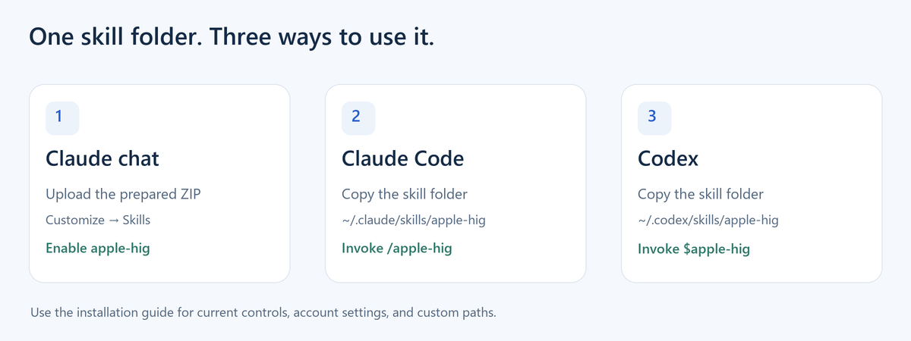

# Installation

Choose the surface you actually use. The same `apple-hig` folder is portable; a GitHub repository ZIP is different from the prepared **skill ZIP**.



## Claude.ai and Claude Desktop chat

1. Download [`dist/apple-hig.zip`](https://github.com/fareslaggoun7/apple-hig-skill/raw/refs/heads/main/dist/apple-hig.zip).
2. Open **Customize → Skills**. Choose **+ → Create skill → Upload a skill**.
3. Upload the ZIP and enable **apple-hig**.
4. Start a chat: `Use the apple-hig skill to review this interface for iOS.`

Code execution must be enabled. If upload or skill controls are unavailable, check your account or organization settings. These instructions were checked against [Anthropic's current help](https://support.claude.com/en/articles/12512180-use-skills-in-claude) on 13 October 2026; labels may change.

The upload contains exactly one root skill folder, matching [Anthropic's packaging guidance](https://support.claude.com/en/articles/12512198-how-to-create-custom-skills):

```text
apple-hig.zip
└── apple-hig/
    ├── SKILL.md
    ├── references/
    ├── scripts/hig.py
    └── agents/openai.yaml
```

The `agents` metadata supports Codex's UI; the skill itself does not depend on it. Uploading to your account is a user step; this repository does not access Claude credentials or install itself remotely.

## Claude Code

```sh
git clone https://github.com/fareslaggoun7/apple-hig-skill.git
cd apple-hig-skill
python tools/install.py --target claude-code
```

This copies the folder to `~/.claude/skills/apple-hig/`. For a project, use `python tools/install.py --target claude-code --skills-dir /path/to/project/.claude/skills` instead. In Claude Code, invoke `/apple-hig` with your task. See [the official location and invocation reference](https://code.claude.com/docs/en/skills#choose-where-skills-load).

## Codex

```sh
python tools/install.py --target codex
```

This uses `$CODEX_HOME/skills/apple-hig/`, or `~/.codex/skills/apple-hig/` when `CODEX_HOME` is unset. Invoke `$apple-hig` with the task. The path follows the [official skill installer](https://github.com/openai/codex/blob/main/codex-rs/skills/src/assets/samples/skill-installer/SKILL.md); see [OpenAI's skill documentation](https://learn.chatgpt.com/docs/build-skills) for your client.

## Windows, macOS, and Linux

The installer and helper require **Python 3.10+**, with no third-party runtime packages. On Windows, `py -3 tools/install.py --target claude-code` is another option. On macOS/Linux, use `python3` when necessary. If you prefer no installer, copy the entire `skills/apple-hig` folder into the appropriate skills directory.

Preview the destination with `--dry-run`. Existing identical skills are left untouched; a differing folder causes the installer to stop. Move your old folder to a backup before replacing it. Use `--skills-dir` for an explicit parent directory. The installer copies only this skill; it does not modify account settings.

## Verify

Ask the assistant to use `apple-hig`, name the target platform, and return the source sections for its important recommendations. For a command-line check:

```sh
python skills/apple-hig/scripts/hig.py audit
python skills/apple-hig/scripts/hig.py show accessibility
```

If the helper cannot access Apple, work from the dated cards or open the linked source through the assistant's browsing capability. Do not present an offline snapshot as freshly verified. Structural compatibility is tested; installation and behavior in a signed-in Claude account have not been exercised by this project.
