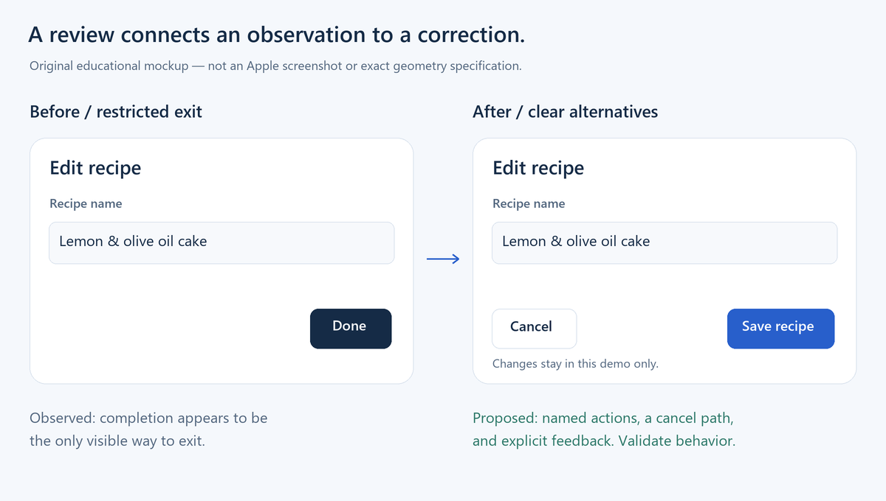

# Examples

Start with a [prompt](prompts.md), inspect a [worked review](review-walkthrough.md), or run the [web adaptation](web-adaptation/README.md). These are original educational examples, not Apple screenshots or native-platform conformance certificates.

| Example | What it demonstrates |
| --- | --- |
| iPad document editor prompt | Platform/window context before navigation choices |
| macOS toolbar review | Connecting an observable issue to a source and correction |
| Sheet review | Preserving a clear exit alternative |
| Web adaptation | Applying relevant principles with web semantics and units |
| Source-conflict prompt | Leaving conflicting exact measurements unresolved |

Run helper commands from the repository root. Prefix Claude Code prompts with `/apple-hig`, or Codex prompts with `$apple-hig`. In Claude chat, ask for the `apple-hig` skill by name.

## Complete interface gallery

[Run the gallery](gallery/README.md), explore [all 173 topic tasks and pictures](gallery/TOPICS.md), and compare [ten motion experiments](gallery/MOTION.md). These are original browser adaptations and explicitly labeled device/SDK models. The skill ZIP remains portable; the complete gallery is distributed separately.
