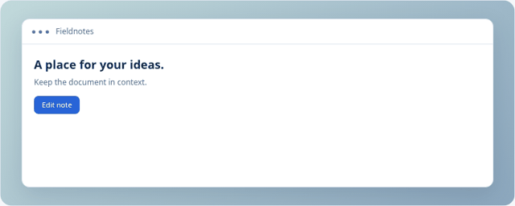
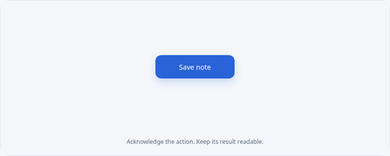
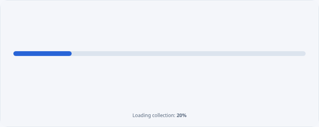
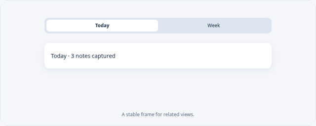
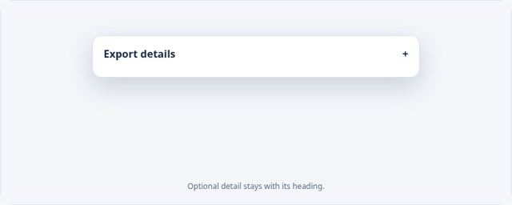
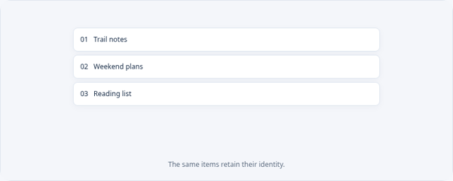

# Ten motion experiments

Open the gallery's `?topic=motion` route. Choose an experiment, replay, pause, or switch to a reduced alternative. All previews below were captured from the same browser renderer used by the live gallery.

These experiments apply the snapshot's [motion guidance](https://developer.apple.com/design/human-interface-guidelines/motion#Best-practices): communicate change, preserve context, allow interruption, and keep essential information available without movement. Durations, easing, spring constants, colors, and dimensions are original example choices, not Apple specifications. The previews are browser illustrations and do not establish native animation or accessibility fidelity.

| Experiment | What to try | Recorded preview |
| --- | --- | --- |
| Spring & retarget | Click Left/Right while the card is moving. Position and velocity continue. |  |
| Sheet presentation | A short focused task appears over a stable document context. |  |
| Anchored popover | Contextual information originates beside its control. |  |
| Press feedback | Immediate feedback keeps the action label understandable. |  |
| Toggle state | The control's position and text convey its state together. |  |
| Progress update | A measurable value and a track convey the same progress. |  |
| Tab transition | The navigation frame remains stable across related views. |  |
| Expand & collapse | Optional details appear in the same local context. |  |
| List reordering | Stable items move to their new positions. |  |
| Reduced alternative | A stationary card changes text directly instead of moving. |  |

The animated previews illustrate transitions. The surrounding lab controls supply replay, pause, and interruption; use the individual sheet, popover, toggle, tabs, progress, disclosure, and reorder topic routes for their complete interactive controls.

## How the spring works

The original example uses acceleration `260 × (target − position) − 32 × velocity` and numerical substeps of at most 1/240 second. Retargeting changes only the target; it preserves position and velocity. Large delayed frames are bounded to avoid unstable integration. This is an educational physical model, not a claim about Apple's spring implementation.

Recorded frames simulate the same spring deterministically. The live retarget and drag specimens advance their existing state each animation frame. Reduced motion substitutes a direct state change; CSS animations and transitions are also disabled.

The frame route `?topic=motion&motion=spring-retarget&record=1&frame=0.7` renders a fixed preview state for recording. Frame values are seconds. No animation loops or audio start automatically.
