# 24 motion examples

Run the [gallery](README.md) and open `?topic=motion`. Choose an example, then replay, pause/resume, reset, or scrub its timeline with the pointer or keyboard. Change speed for inspection, enable looping deliberately, or retarget the spring while it moves. Each example has a direct link, a source section, a companion interactive topic, and an explicit reduced alternative.

The documentation uses still frames by default. Open a linked recording when you want movement. Recorded GIFs play twice, hold their final frame, and then stop; they cannot follow your system preference. The live player respects system Reduce Motion and its local opt-in, including changes during playback, without resetting your selection or timeline. No animation or loop starts automatically.

## Guidance and scope

Apple’s [Motion → Best practices](https://developer.apple.com/design/human-interface-guidelines/motion#Best-practices) recommends purposeful, optional motion. [Providing feedback](https://developer.apple.com/design/human-interface-guidelines/motion#Providing-feedback) recommends realistic relationships, brevity and precision, generally avoiding extra animation for frequent interactions, and allowing cancellation as much as possible. These sections were retrieved on 15 October 2026 and matched the recorded fingerprints. The [portable motion workflow](../../skills/apple-hig/references/motion-design.md) explains how to apply them.

These are original browser illustrations. Durations, easing, physics, dimensions, and colors are educational choices, not Apple specifications. The 2.8-second inspection timeline includes time to see the result; it does not prescribe a production interaction delay. The preview stage is inert artwork; use the surrounding real HTML player controls or open the full companion topic for keyboard interaction, dialog cancellation, and focus recovery. Loading, refresh, and save events are local illustrations.

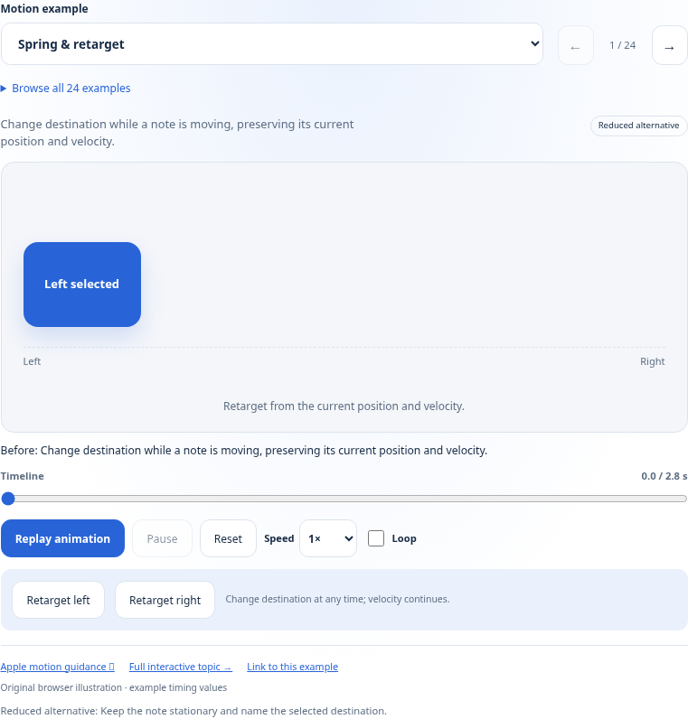

## Continuity

| Example and purpose | Still frame → recording | Reduced alternative |
| --- | --- | --- |
| [Spring & retarget](index.html?topic=motion&motion=spring-retarget) Change destination while a note is moving, preserving its current position and velocity. Result: The note settles at the selected destination. [Apple section](https://developer.apple.com/design/human-interface-guidelines/motion#Best-practices) · [Full topic](index.html?topic=gestures) | [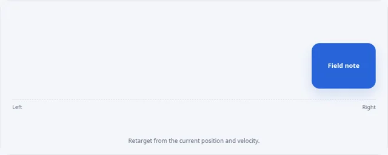](../../docs/assets/motion-spring-retarget.gif) [Play recording](../../docs/assets/motion-spring-retarget.gif) | 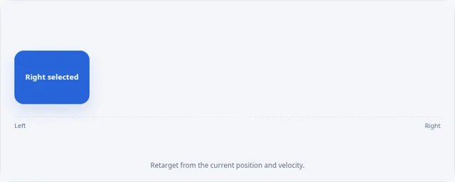 Keep the note stationary and name the selected destination. |
| [Reduced alternative](index.html?topic=motion&motion=reduced-motion) Communicate the same completed update using stationary text and a checkmark. Result: The stationary note reads Updated. [Apple section](https://developer.apple.com/design/human-interface-guidelines/motion#Best-practices) · [Full topic](index.html?topic=accessibility) | [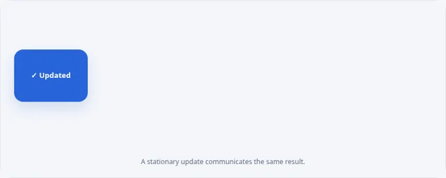](../../docs/assets/motion-reduced-motion.gif) [Play recording](../../docs/assets/motion-reduced-motion.gif) |  This example is stationary in both modes. |
| [Shared element](index.html?topic=motion&motion=shared-element) Keep the same original landscape recognizable as its card becomes a detail header. Result: The landscape is shown in a larger detail header. [Apple section](https://developer.apple.com/design/human-interface-guidelines/motion#Best-practices) · [Full topic](index.html?topic=images) |  [Play recording](../../docs/assets/motion-shared-element.gif) | 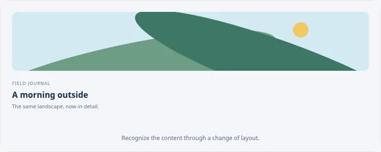 Replace the card with its final detail layout. |
| [Focus emphasis](index.html?topic=motion&motion=focus-transition) Illustrate a restrained focus change with a border and explicit Focused label. Result: Evening walk is identified as the focused card. [Apple section](https://developer.apple.com/design/human-interface-guidelines/motion#Best-practices) · [Full topic](index.html?topic=focus-and-selection) | [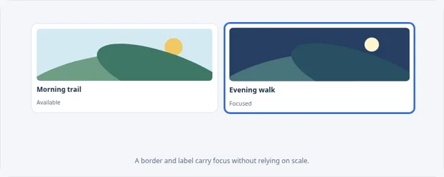](../../docs/assets/motion-focus-transition.gif) [Play recording](../../docs/assets/motion-focus-transition.gif) | 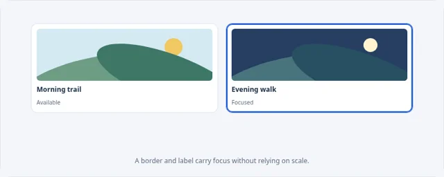 Change the focus border and text without enlarging cards. |

## Navigation

| Example and purpose | Still frame → recording | Reduced alternative |
| --- | --- | --- |
| [Sheet presentation](index.html?topic=motion&motion=sheet-presentation) Introduce a focused editing task while preserving the document behind it. Result: The editing sheet is open above the document. [Apple section](https://developer.apple.com/design/human-interface-guidelines/motion#Best-practices) · [Full topic](index.html?topic=sheets) |  [Play recording](../../docs/assets/motion-sheet-presentation.gif) | 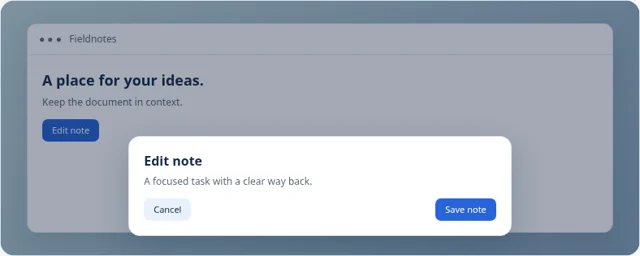 Reveal the sheet and dimmed context directly. |
| [Anchored popover](index.html?topic=motion&motion=popover-origin) Associate document details with the control that opened them. Result: Document details are visible beside their source. [Apple section](https://developer.apple.com/design/human-interface-guidelines/motion#Best-practices) · [Full topic](index.html?topic=popovers) | [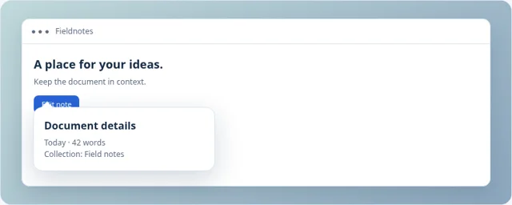](../../docs/assets/motion-popover-origin.gif) [Play recording](../../docs/assets/motion-popover-origin.gif) |  Show the details directly at their final location. |
| [Tab transition](index.html?topic=motion&motion=tab-transition) Replace related content while keeping the navigation frame stable. Result: Week is selected and its 18 notes are visible. [Apple section](https://developer.apple.com/design/human-interface-guidelines/motion#Best-practices) · [Full topic](index.html?topic=tab-bars) |  [Play recording](../../docs/assets/motion-tab-transition.gif) | 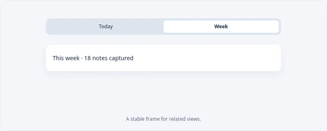 Replace content directly and keep the selected-tab label. |
| [Navigate to detail](index.html?topic=motion&motion=navigation-push) Follow a note into its detail view while retaining a clear collection relationship. Result: Trail notes detail is open, with a collection back label. [Apple section](https://developer.apple.com/design/human-interface-guidelines/motion#Best-practices) · [Full topic](index.html?topic=navigation-and-search) | [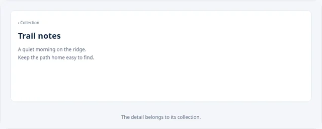](../../docs/assets/motion-navigation-push.gif) [Play recording](../../docs/assets/motion-navigation-push.gif) |  Replace the collection with detail without sliding. |
| [Return to collection](index.html?topic=motion&motion=navigation-back) Reverse the detail transition to return to the originating collection. Result: The collection is visible with Trail notes identified. [Apple section](https://developer.apple.com/design/human-interface-guidelines/motion#Best-practices) · [Full topic](index.html?topic=navigation-and-search) |  [Play recording](../../docs/assets/motion-navigation-back.gif) | 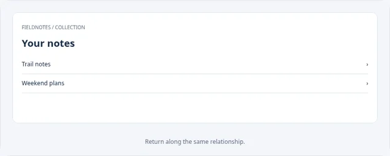 Replace detail with the collection directly. |
| [Selection highlight](index.html?topic=motion&motion=selection-highlight) Move a restrained indicator between related views while preserving their labels. Result: Week is selected; the 18-note total is visible. [Apple section](https://developer.apple.com/design/human-interface-guidelines/motion#Best-practices) · [Full topic](index.html?topic=segmented-controls) |  [Play recording](../../docs/assets/motion-selection-highlight.gif) |  Change the indicator and selected label directly. |

## Feedback

| Example and purpose | Still frame → recording | Reduced alternative |
| --- | --- | --- |
| [Press feedback](index.html?topic=motion&motion=button-feedback) Acknowledge a save promptly, with a readable result that remains visible. Result: The note is saved; the confirmation remains visible. [Apple section](https://developer.apple.com/design/human-interface-guidelines/motion#Providing-feedback) · [Full topic](index.html?topic=buttons) |  [Play recording](../../docs/assets/motion-button-feedback.gif) | 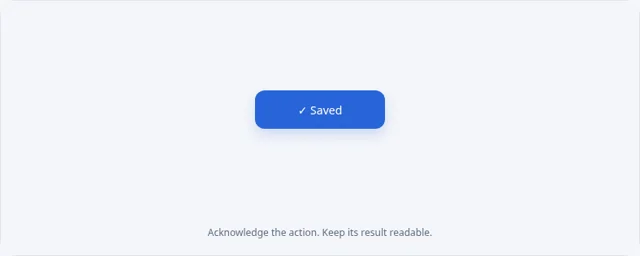 Change the label to Saved without scaling. |
| [Toggle state](index.html?topic=motion&motion=toggle-state) Coordinate the control position, checkmark, and explicit On or Off label. Result: Reading reminders are On. [Apple section](https://developer.apple.com/design/human-interface-guidelines/motion#Providing-feedback) · [Full topic](index.html?topic=toggles) | [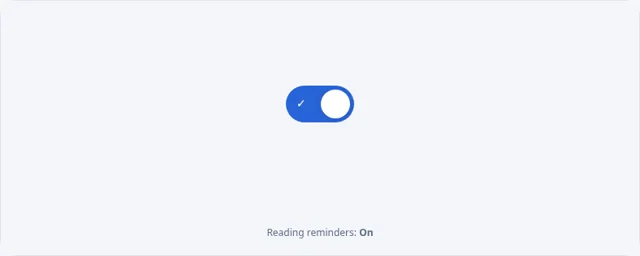](../../docs/assets/motion-toggle-state.gif) [Play recording](../../docs/assets/motion-toggle-state.gif) |  Switch directly to the checked On state. |
| [Progress update](index.html?topic=motion&motion=progress-update) Keep the numeric value and measurable progress track in agreement. Result: Collection loading has reached 85 percent. [Apple section](https://developer.apple.com/design/human-interface-guidelines/motion#Providing-feedback) · [Full topic](index.html?topic=progress-indicators) | [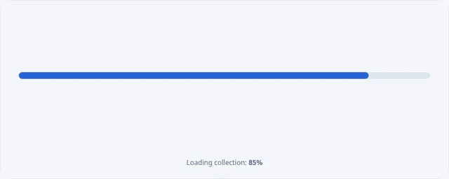](../../docs/assets/motion-progress-update.gif) [Play recording](../../docs/assets/motion-progress-update.gif) |  Update the track and value directly, without interpolating. |
| [Loading to content](index.html?topic=motion&motion=loading-handoff) Replace a quiet placeholder with readable content in the same bounds. Result: Trail notes is ready; the loading placeholder is gone. [Apple section](https://developer.apple.com/design/human-interface-guidelines/motion#Providing-feedback) · [Full topic](index.html?topic=loading) |  [Play recording](../../docs/assets/motion-loading-handoff.gif) | 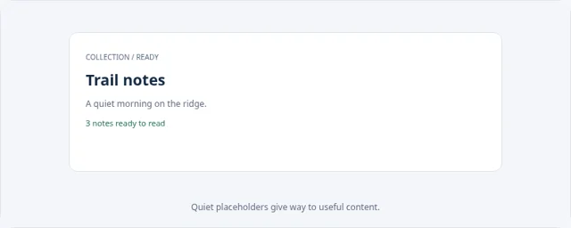 Replace the placeholder with loaded content directly. |
| [Refresh feedback](index.html?topic=motion&motion=pull-refresh) Illustrate a refresh that ends with an explicit update time; no network request occurs. Result: The local illustration says Updated just now. [Apple section](https://developer.apple.com/design/human-interface-guidelines/motion#Providing-feedback) · [Full topic](index.html?topic=loading) | [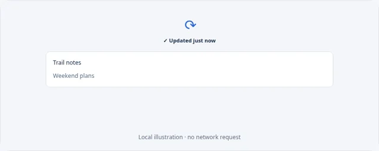](../../docs/assets/motion-pull-refresh.gif) [Play recording](../../docs/assets/motion-pull-refresh.gif) | 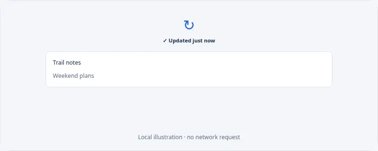 Keep the indicator stationary and update its status text. |
| [Save confirmation](index.html?topic=motion&motion=toast-feedback) Acknowledge completion near the task without hiding the document. Result: A persistent Note saved confirmation is visible. [Apple section](https://developer.apple.com/design/human-interface-guidelines/motion#Providing-feedback) · [Full topic](index.html?topic=feedback) |  [Play recording](../../docs/assets/motion-toast-feedback.gif) | 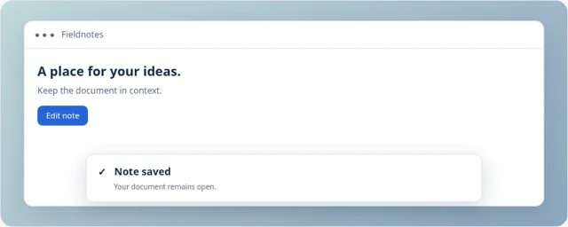 Show the confirmation directly without sliding. |
| [Inline validation](index.html?topic=motion&motion=validation-feedback) Explain what needs correction beside the field, without shaking the interface. Result: The title field has a readable Enter a title correction. [Apple section](https://developer.apple.com/design/human-interface-guidelines/motion#Providing-feedback) · [Full topic](index.html?topic=entering-data) | [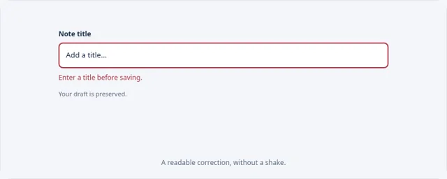](../../docs/assets/motion-validation-feedback.gif) [Play recording](../../docs/assets/motion-validation-feedback.gif) |  Show the same error directly, without movement. |
| [Numeric change](index.html?topic=motion&motion=number-change) Associate a changed total with its label and unit, retaining the exact final value. Result: The reading total is 85 minutes. [Apple section](https://developer.apple.com/design/human-interface-guidelines/motion#Providing-feedback) · [Full topic](index.html?topic=gauges) |  [Play recording](../../docs/assets/motion-number-change.gif) | 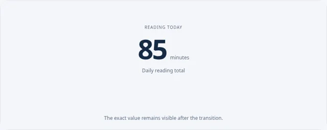 Replace 20 with 85 directly; keep minutes visible. |

## Content

| Example and purpose | Still frame → recording | Reduced alternative |
| --- | --- | --- |
| [Expand & collapse](index.html?topic=motion&motion=expand-collapse) Reveal optional export details in the same local context. Result: Export details are expanded. [Apple section](https://developer.apple.com/design/human-interface-guidelines/motion#Best-practices) · [Full topic](index.html?topic=disclosure-controls) |  [Play recording](../../docs/assets/motion-expand-collapse.gif) | 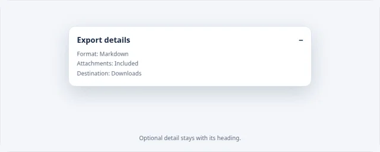 Show the complete details directly. |
| [List reordering](index.html?topic=motion&motion=reorder-list) Track the identities of items as their positions change. Result: Weekend plans precedes Trail notes; Reading list stays third. [Apple section](https://developer.apple.com/design/human-interface-guidelines/motion#Best-practices) · [Full topic](index.html?topic=drag-and-drop) |  [Play recording](../../docs/assets/motion-reorder-list.gif) | 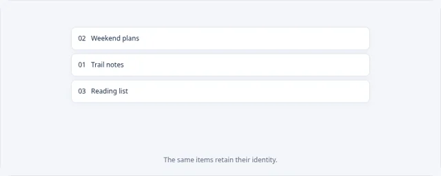 Change the order directly, preserving item labels. |
| [Image replacement](index.html?topic=motion&motion=crossfade-media) Replace an image within fixed bounds, so surrounding content does not jump. Result: The evening landscape replaces the morning image. [Apple section](https://developer.apple.com/design/human-interface-guidelines/motion#Best-practices) · [Full topic](index.html?topic=image-views) |  [Play recording](../../docs/assets/motion-crossfade-media.gif) | 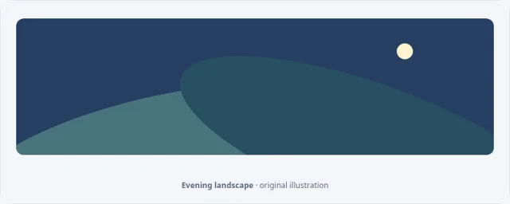 Swap the two images directly. |
| [Filter a collection](index.html?topic=motion&motion=search-filter) Keep matching results recognizable while nonmatching items leave the list. Result: Two matching notes remain, with a readable result count. [Apple section](https://developer.apple.com/design/human-interface-guidelines/motion#Best-practices) · [Full topic](index.html?topic=searching) | [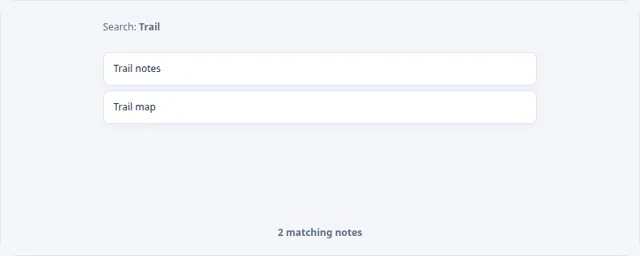](../../docs/assets/motion-search-filter.gif) [Play recording](../../docs/assets/motion-search-filter.gif) |  Show the two matching results directly. |
| [Insert an item](index.html?topic=motion&motion=list-insert) Make room for a new note while keeping existing items identifiable. Result: Morning sketch is first; the previous notes remain below it. [Apple section](https://developer.apple.com/design/human-interface-guidelines/motion#Best-practices) · [Full topic](index.html?topic=lists-and-tables) |  [Play recording](../../docs/assets/motion-list-insert.gif) | 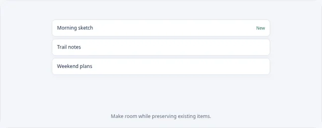 Show the new list order directly. |
| [Remove & undo](index.html?topic=motion&motion=undo-removal) Illustrate removal followed by an explicit undo that restores the same item. Result: Undo restores Weekend plans to its original position. [Apple section](https://developer.apple.com/design/human-interface-guidelines/motion#Best-practices) · [Full topic](index.html?topic=undo-and-redo) |  [Play recording](../../docs/assets/motion-undo-removal.gif) | 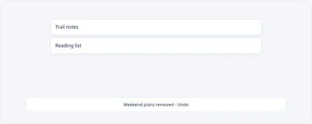 Use direct removed and restored states with explicit text. |

## Continuity, lifetime, and recording

The spring uses original acceleration `260 × (target − position) − 32 × velocity`, with numerical substeps of at most 1/240 second and bounded delayed frames. Retargeting changes only its target. It preserves position and velocity, and responsive geometry is recalculated when the stage changes size. This is an educational model, not Apple’s native spring implementation.

Pause/resume retains elapsed time; speed changes affect subsequent time. Reset and navigation cancel scheduled frames. Hidden-page playback pauses and requires an explicit resume. A completed transition holds its useful result. Live status describes meaningful actions and outcomes rather than announcing every frame.

The record route `?topic=motion&motion=shared-element&record=1&frame=0.7` renders a deterministic frame in seconds. Add `reduced=1` for its direct alternative. The same renderers supply the player, 48 still previews, and 24 GIF recordings; each recording samples 43 timeline positions including the endpoint. The undo still intentionally shows its removed state so the recovery opportunity is visible.

## Verification

The controlled-clock browser suite exercises all examples in both modes, normal and reduced endpoints, keyboard scrubbing, pause/resume, speed changes, optional loops, spring interruption, resizing, dynamic system preferences, hidden-page pausing, and cleanup after navigation. It also checks all 24 examples at 320px, 390px, and 1280px in light and dark appearances. See [executed checks](../../docs/TESTING.md). Screenshots and these software checks do not establish native animation fidelity, assistive-technology correctness, device comfort, or a numerical semantic error bound.
