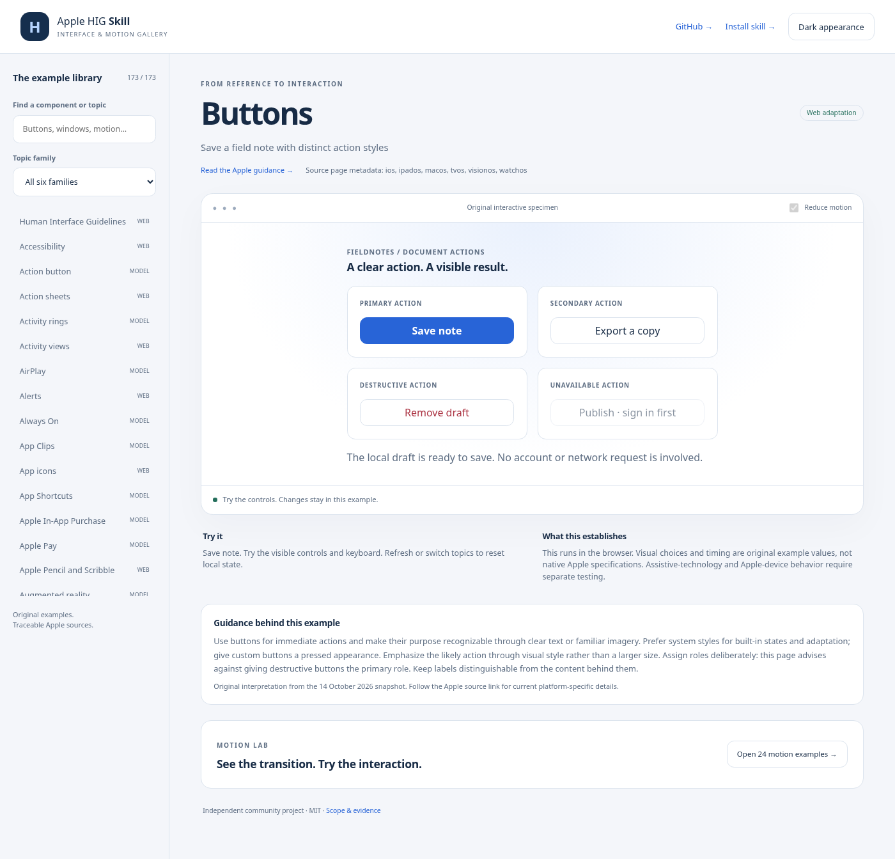

# Interface & motion gallery

**173 source-linked topic routes, actual rendered pictures, and 24 motion examples.** The gallery runs entirely in a browser, without a build step or runtime dependencies.

From the repository root:

```sh
python3 -m http.server 8000 --directory examples/gallery --bind 127.0.0.1
```

In your browser, enter `http://127.0.0.1:8000`. Use `?topic=buttons`, `?topic=sheets`, or `?topic=motion` to open a specific example. Opening `index.html` directly as a file will not work: ES modules and the catalog require HTTP. On Windows, use `python` instead of `python3` if needed.

[All 173 topics and pictures](TOPICS.md) · [Motion experiments](MOTION.md) · [Source coverage](../../docs/COVERAGE.md)



## What you can do

- Save and cancel edits in real HTML dialogs and sheets; Escape preserves the original draft and restores focus.
- Use search, tabs, sidebars, split views, menus, popovers, tables, controls, and validated forms.
- Draw on a canvas, reorder a list with drag or buttons, and interrupt a card's spring-based snap.
- Exercise loading completion, cancellation, simulated failure, and retry.
- Play an optional quiet generated tone or an original animated illustration, with a visible alternative.
- Explore explicitly labeled device, payment, account, and SDK models. No purchase, authentication, invitation, sensor access, or system integration occurs.

Search and family filters cover the entire library. Browser history restores topic routes. Each example shows its concrete task, current source link, dated source-card guidance, and scope. Local state resets when switching topics or refreshing. Timers, listeners, animations, and audio are cleaned up when leaving an example.

## Motion and accessibility

The system's reduced-motion preference is respected at startup and when it changes. The Reduce motion control also provides a local override. The 24-example motion player offers replay, pause/resume, reset, pointer/keyboard timeline scrubbing, playback speed, optional looping, and direct links. The spring accepts new destinations without resetting position or velocity and stays within bounds after resizing. Reduced motion preserves the selected example, timeline, and pause state; system reduction cannot be accidentally disabled in the lab. The reduced spring uses stationary destination text. Completed transitions retain their useful outcome, and hidden-page playback pauses until explicitly resumed. Still previews are the documentation default; linked recordings play twice and stop.

The gallery uses native HTML controls, dialog focus handling, visible focus, live result text, captions, and keyboard alternatives for pointer operations. Browser checks do not establish full accessibility conformance. Screen readers, Apple devices, native frameworks, spatial comfort, and real SDK integrations need separate testing.

## Verification and regeneration

Python 3.10+ and Node 20+ are sufficient for the portable package and pure gallery tests:

```sh
python3 -m unittest discover -s tests -v
python3 tools/build_gallery_catalog.py --check
node --test tests/gallery.test.mjs
python3 tools/package.py --check
python3 tools/package_gallery.py --check
```

Browser checks and screenshot regeneration additionally need Playwright, Chromium, and Pillow. These are development tools; visitors and skill users do not need them. With the server running in another terminal:

```sh
npm install --prefix work/browser-tools --no-audit --no-fund --ignore-scripts playwright@1.56.1
node work/browser-tools/node_modules/playwright/cli.js install chromium
```

Set `NODE_PATH` to the absolute path of `work/browser-tools/node_modules` for the following commands. You can set `PLAYWRIGHT_CHROMIUM_EXECUTABLE` to an existing compatible Chromium executable; the tools also detect `/usr/bin/chromium` on Linux.

```sh
node tools/check_gallery_browser.mjs
python3 -m pip install Pillow
node tools/capture_gallery.mjs
python3 tools/build_gallery_catalog.py
python3 tools/package_gallery.py
```

The browser suite loads every route at 1280px and 390px, checks horizontal overflow, and exercises representative stateful interactions. The capture tool takes all 173 topic pictures from their live renderers and samples 43 timeline positions per motion GIF, including the final frame, and captures 48 normal/reduced still previews. The hero combines actual specimen screenshots with original typography and layout. No Apple interface artwork is redistributed.

## Optional public hosting

The gallery is suitable for any static host. The repository includes an optional **Publish gallery** GitHub Actions workflow. An administrator can enable Pages with **Source: GitHub Actions**, then run that workflow. Verify the deployed URL before treating it as live. The local workflow and release ZIP do not require Pages.

The 14 October 2026 source snapshot is a topic inventory and selective interpretation. All 173 routes being present does not establish semantic correctness, native fidelity, or the requested less-than-0.01% interpretation error rate.
