# Platform and design workshops

Work through these topics in the requested order. Each workshop contains concrete, source-linked browser tasks, an implementation guide in the portable skill, and pictures captured from its actual renderers. Run the [gallery](README.md) before opening the HTML routes.

Choose a study; use its controls, keyboard, text-size and layout studies, appearance switch, and reset. Individual studies preserve their local state when revisited. Changing a gallery topic or refreshing starts a new workshop. These original HTML adaptations do not establish native device behavior, SDK availability, assistive-technology conformance, or a numerical semantic error bound.

## 1. Designing for iOS

Original HTML adaptation. Text scaling and layout changes are browser studies, not native Dynamic Type or iPhone gesture validation.

[Open workshop](index.html?topic=designing-for-ios) · [Implementation guide](../../skills/apple-hig/references/workshops/ios.md)

| Study | Task and source | Actual rendered picture |
| --- | --- | --- |
| [Library & return](index.html?topic=designing-for-ios&example=library) | Open an article, save it, and return to the same collection. [Apple section](https://developer.apple.com/design/human-interface-guidelines/designing-for-ios#Best-practices) | 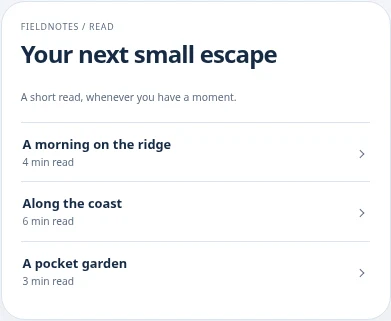 |
| [Search & no results](index.html?topic=designing-for-ios&example=search) | Find an article, then recover from a search with no matches. [Apple section](https://developer.apple.com/design/human-interface-guidelines/designing-for-ios#Best-practices) | 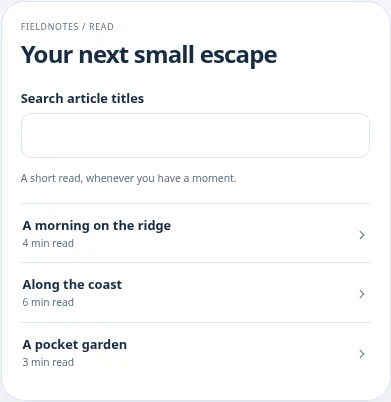 |
| [Edit & cancel](index.html?topic=designing-for-ios&example=compose) | Edit a note in a focused sheet, validate an empty title, and cancel without losing the original. [Apple section](https://developer.apple.com/design/human-interface-guidelines/designing-for-ios#Best-practices) | 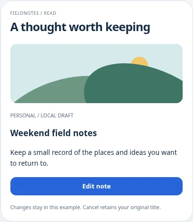 |
| [Navigation & saved state](index.html?topic=designing-for-ios&example=tab-state) | Save an article in Library and find it under Saved without losing its state. [Apple section](https://developer.apple.com/design/human-interface-guidelines/designing-for-ios#Best-practices) | 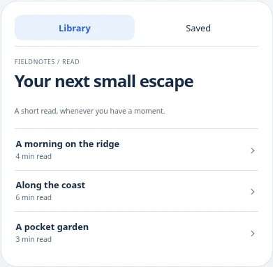 |
| [Adaptable reading](index.html?topic=designing-for-ios&example=reading) | Change the study width, text size, and appearance while keeping the same reading task. [Apple section](https://developer.apple.com/design/human-interface-guidelines/designing-for-ios#Best-practices) | 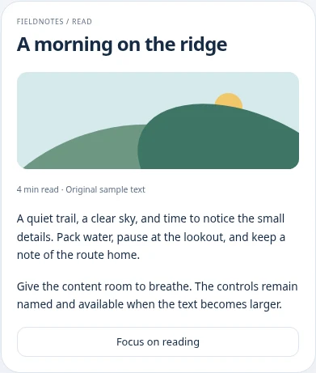 |
| [Loading & recovery](index.html?topic=designing-for-ios&example=load-recovery) | Load a local collection, cancel it, or simulate a failure and retry. [Apple section](https://developer.apple.com/design/human-interface-guidelines/designing-for-ios#Best-practices) | 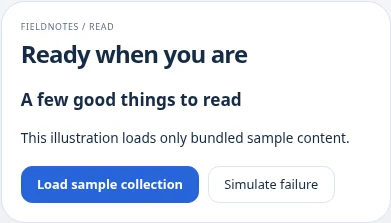 |

## 2. Designing for iPadOS

A responsive HTML document workspace. Keyboard and pointer tasks run in the browser; native multitasking, Apple Pencil and inter-app transfer remain unverified.

[Open workshop](index.html?topic=designing-for-ipados) · [Implementation guide](../../skills/apple-hig/references/workshops/ipados.md)

| Study | Task and source | Actual rendered picture |
| --- | --- | --- |
| [Persistent workspace](index.html?topic=designing-for-ipados&example=workspace) | Switch collections and documents while preserving each editable draft. [Apple section](https://developer.apple.com/design/human-interface-guidelines/designing-for-ipados#Best-practices) | 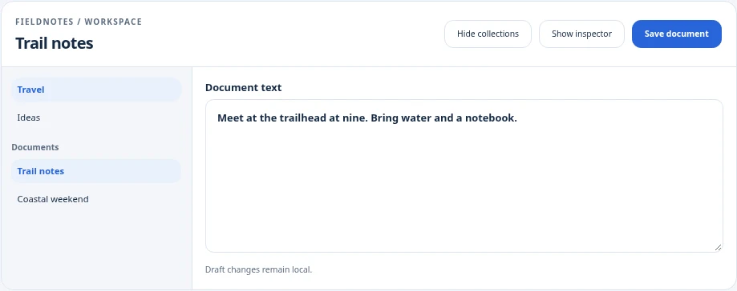 |
| [Resize without losing work](index.html?topic=designing-for-ipados&example=adaptation) | Edit a draft, then change layout and text size without losing the selected document. [Apple section](https://developer.apple.com/design/human-interface-guidelines/designing-for-ipados#Best-practices) |  |
| [Nonmodal inspector](index.html?topic=designing-for-ipados&example=inspector) | Inspect document details while editing the same document. [Apple section](https://developer.apple.com/design/human-interface-guidelines/designing-for-ipados#Best-practices) | 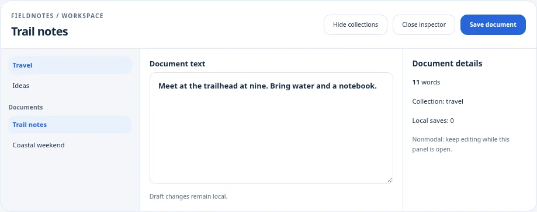 |
| [Keyboard & named actions](index.html?topic=designing-for-ipados&example=keyboard) | Save using the scoped keyboard command and the visible equivalent button. [Apple section](https://developer.apple.com/design/human-interface-guidelines/designing-for-ipados#Best-practices) |  |
| [Sketch beside a note](index.html?topic=designing-for-ipados&example=sketch-transfer) | Draw or add a sample stroke, then transfer a bundled clip into a related note. [Apple section](https://developer.apple.com/design/human-interface-guidelines/designing-for-ipados#Best-practices) | 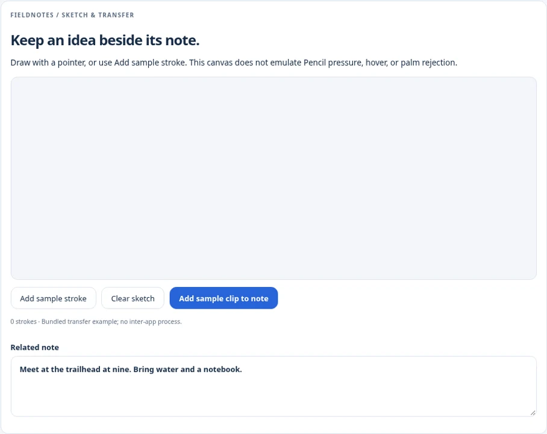 |

## 3. Designing for macOS

An original HTML document and command workspace. System menu bars, windows, file coordination, native full-screen and precision-device behavior require macOS validation.

[Open workshop](index.html?topic=designing-for-macos) · [Implementation guide](../../skills/apple-hig/references/workshops/macos.md)

| Study | Task and source | Actual rendered picture |
| --- | --- | --- |
| [Documents without lost drafts](index.html?topic=designing-for-macos&example=documents) | Edit two documents and return to each preserved draft. [Apple section](https://developer.apple.com/design/human-interface-guidelines/designing-for-macos#Best-practices) | 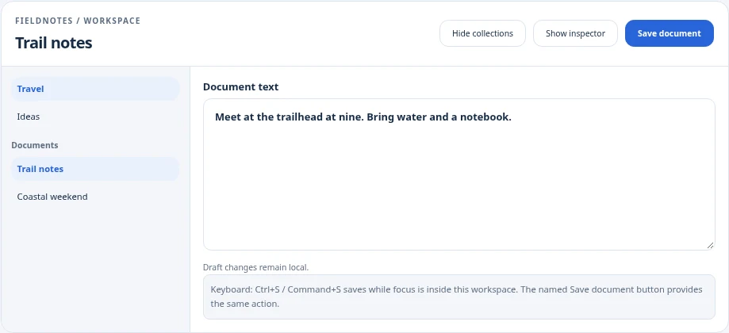 |
| [Discoverable commands & undo](index.html?topic=designing-for-macos&example=commands) | Open the command list, create a document, apply a revision, and undo it. [Apple section](https://developer.apple.com/design/human-interface-guidelines/designing-for-macos#Best-practices) | 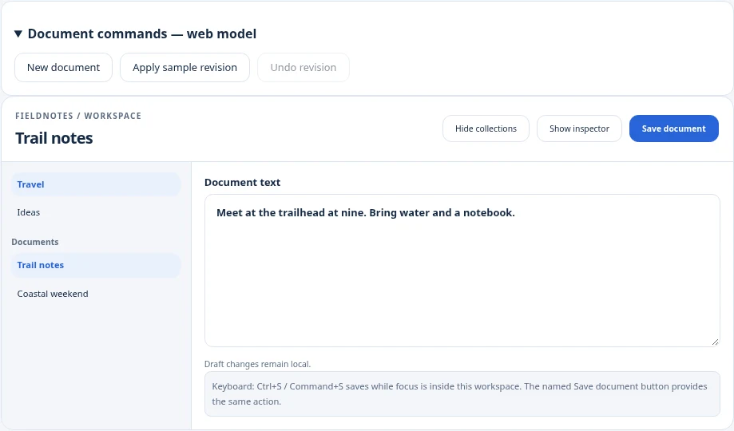 |
| [Personalize a toolbar](index.html?topic=designing-for-macos&example=personalize) | Choose which optional toolbar commands are visible while preserving the draft. [Apple section](https://developer.apple.com/design/human-interface-guidelines/designing-for-macos#Best-practices) | 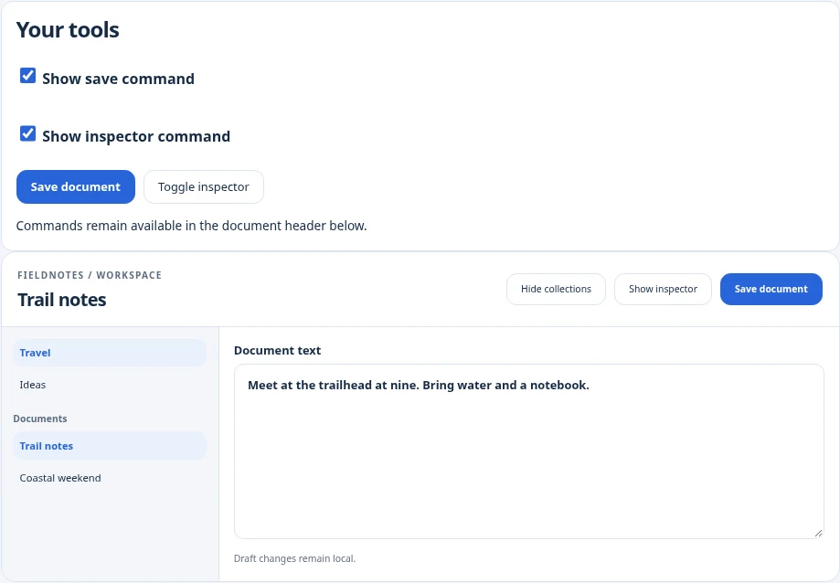 |
| [A focused work context](index.html?topic=designing-for-macos&example=focus) | Enter and leave a local focused layout without losing edited content. [Apple section](https://developer.apple.com/design/human-interface-guidelines/designing-for-macos#Best-practices) | 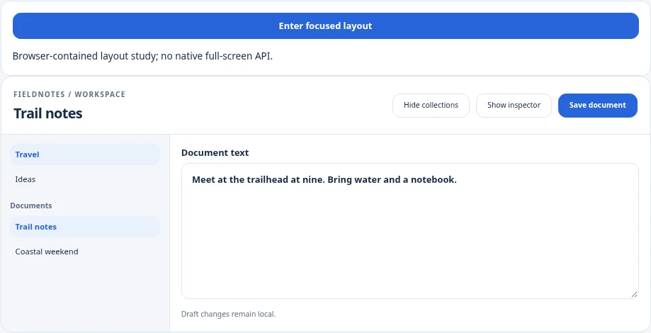 |
| [Precise, named adjustments](index.html?topic=designing-for-macos&example=precision) | Position a marker with a range control or one-step named buttons. [Apple section](https://developer.apple.com/design/human-interface-guidelines/designing-for-macos#Best-practices) | 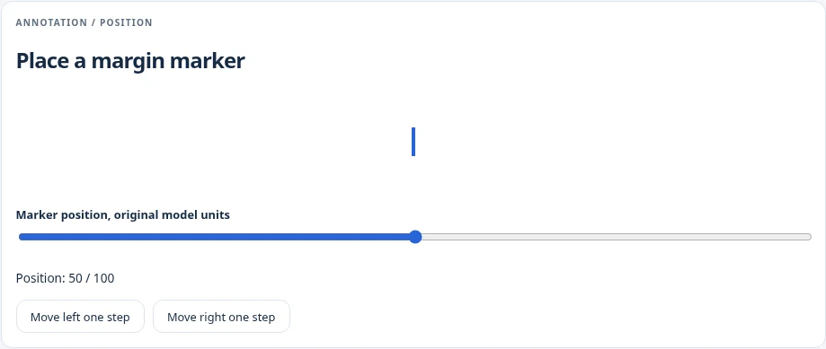 |

## 4. Designing for watchOS

Original watch-sized web studies of brief tasks. Native complications, notifications, Always On, sensors, Action button, and Digital Crown behavior are not exercised.

[Open workshop](index.html?topic=designing-for-watchos) · [Implementation guide](../../skills/apple-hig/references/workshops/watchos.md)

| Study | Task and source | Actual rendered picture |
| --- | --- | --- |
| [One useful glance](index.html?topic=designing-for-watchos&example=glance) | Read the next action and choose another bundled context. [Apple section](https://developer.apple.com/design/human-interface-guidelines/designing-for-watchos#Best-practices) |  |
| [Start, pause, resume](index.html?topic=designing-for-watchos&example=session) | Run a short timer, pause it, and reset without navigating through setup screens. [Apple section](https://developer.apple.com/design/human-interface-guidelines/designing-for-watchos#Best-practices) | 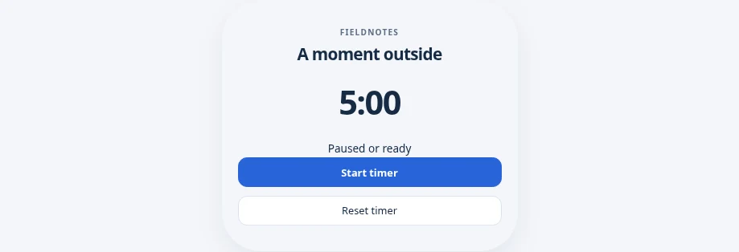 |
| [Rotary input alternatives](index.html?topic=designing-for-watchos&example=crown) | Choose a duration through an ordinary range control or named step buttons. [Apple section](https://developer.apple.com/design/human-interface-guidelines/designing-for-watchos#Best-practices) | 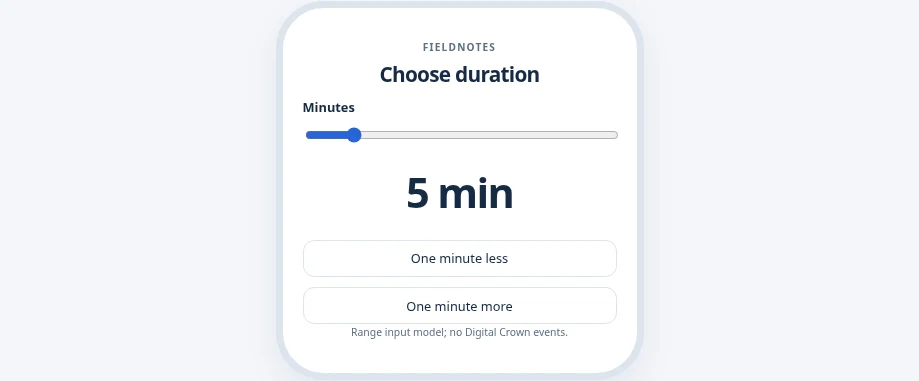 |
| [Glance to useful detail](index.html?topic=designing-for-watchos&example=complication) | Open a complication-like entry and return to the same concise context. [Apple section](https://developer.apple.com/design/human-interface-guidelines/designing-for-watchos#Best-practices) |  |
| [A targeted notification action](index.html?topic=designing-for-watchos&example=notification) | Acknowledge a bundled event or open its details without a long setup flow. [Apple section](https://developer.apple.com/design/human-interface-guidelines/designing-for-watchos#Best-practices) |  |

## 5. Designing for iPhone Duo

Source-guided responsive HTML models of display transitions and reserved space. No hardware pose detection, native reserved-region APIs, or device dimensions are implemented.

[Open workshop](index.html?topic=designing-for-iphone-duo) · [Implementation guide](../../skills/apple-hig/references/workshops/duo.md)

| Study | Task and source | Actual rendered picture |
| --- | --- | --- |
| [One hierarchy, changing space](index.html?topic=designing-for-iphone-duo&example=display-contexts) | Open a note on the compact display model, then show its collection beside it. [Apple section](https://developer.apple.com/design/human-interface-guidelines/designing-for-iphone-duo#Best-practices) | 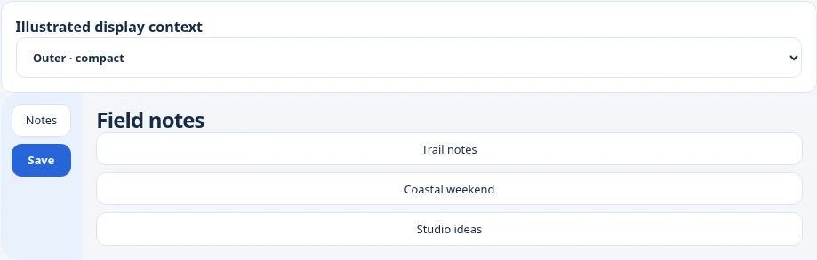 |
| [Preserve the work](index.html?topic=designing-for-iphone-duo&example=draft-continuity) | Edit multiple notes and change display context without losing selection or drafts. [Apple section](https://developer.apple.com/design/human-interface-guidelines/designing-for-iphone-duo#Best-practices) |  |
| [Adapt around reserved space](index.html?topic=designing-for-iphone-duo&example=reserved-space) | Toggle camera and folding-region illustrations while keeping content operable. [Apple section](https://developer.apple.com/design/human-interface-guidelines/designing-for-iphone-duo#Reserved-regions) | 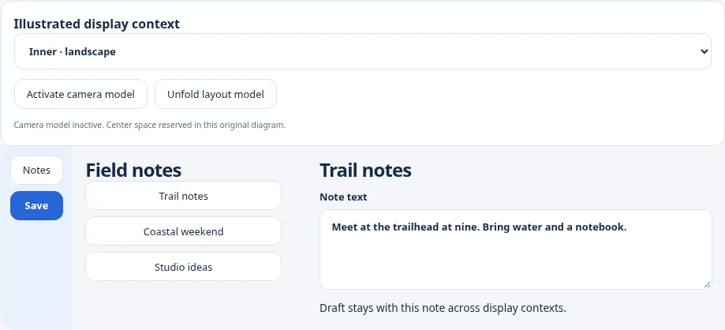 |
| [Arrange content, retain navigation](index.html?topic=designing-for-iphone-duo&example=arrangement) | Compare split and layered content arrangements, then change the available context. [Apple section](https://developer.apple.com/design/human-interface-guidelines/designing-for-iphone-duo#Arrangement-views) | 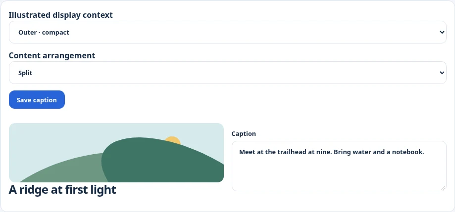 |
| [Keep useful actions available](index.html?topic=designing-for-iphone-duo&example=action-overflow) | Compress secondary actions, create a note, and find the same tag action in overflow. [Apple section](https://developer.apple.com/design/human-interface-guidelines/designing-for-iphone-duo#Vertical-controls) | 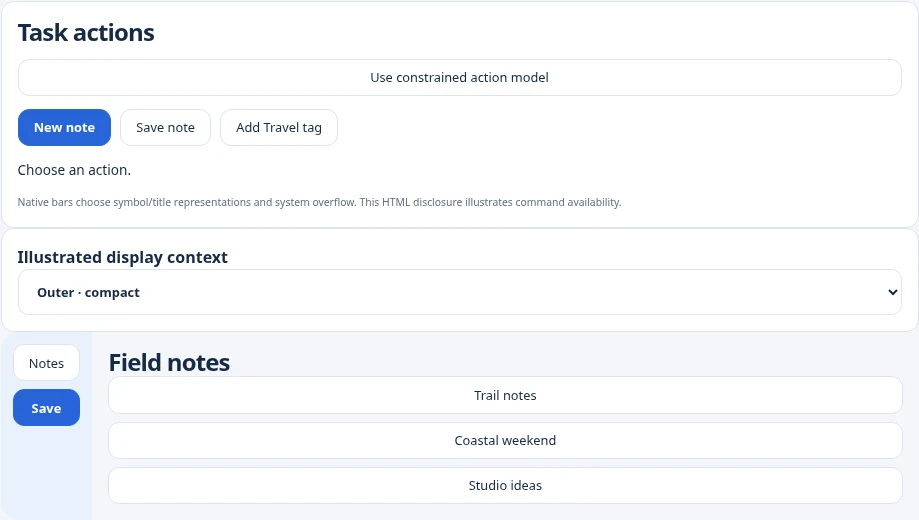 |

## 6. Design principles

Eight original interactive studies, one for each current named Apple design principle. Product decisions and illustrative outcomes are not universal rules or design certification.

[Open workshop](index.html?topic=design-principles) · [Implementation guide](../../skills/apple-hig/references/workshops/principles.md)

| Study | Task and source | Actual rendered picture |
| --- | --- | --- |
| [Purpose · capture the useful thought](index.html?topic=design-principles&example=purpose) | Capture a useful note directly; recover from empty input. [Apple section](https://developer.apple.com/design/human-interface-guidelines/design-principles#Purpose) | 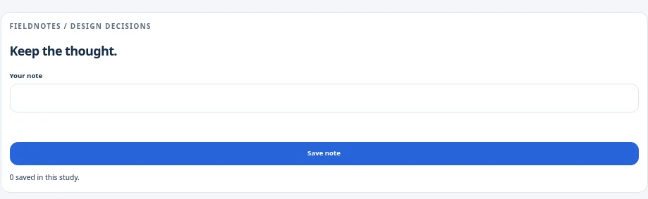 |
| [Agency · make recovery easy](index.html?topic=design-principles&example=agency) | Archive a note, then recover the same content with Undo. [Apple section](https://developer.apple.com/design/human-interface-guidelines/design-principles#Agency) | 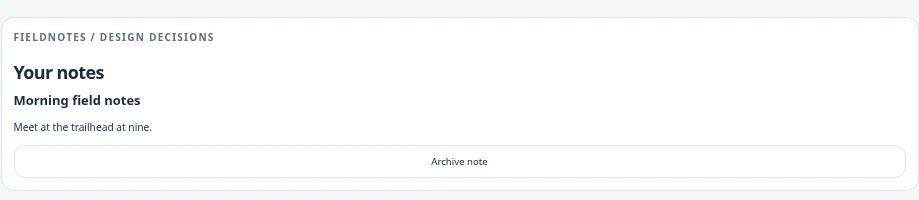 |
| [Responsibility · explain data use](index.html?topic=design-principles&example=responsibility) | Choose manual place entry or inspect a bundled location example. [Apple section](https://developer.apple.com/design/human-interface-guidelines/design-principles#Responsibility) | 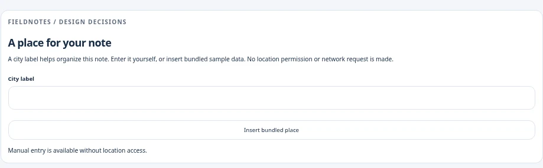 |
| [Familiarity · consistent action feedback](index.html?topic=design-principles&example=familiarity) | Save either of two notes using the same named action and state feedback. [Apple section](https://developer.apple.com/design/human-interface-guidelines/design-principles#Familiarity) | 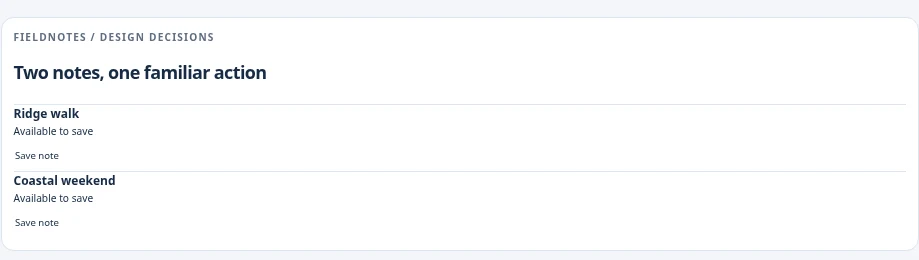 |
| [Flexibility · alternative input paths](index.html?topic=design-principles&example=flexibility) | Reorder an itinerary with named keyboard-operable actions, then change layout or text size. [Apple section](https://developer.apple.com/design/human-interface-guidelines/design-principles#Flexibility) | 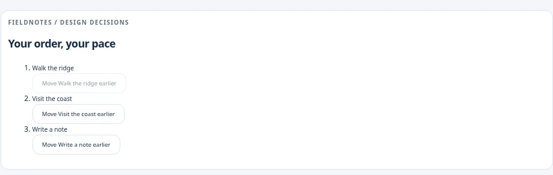 |
| [Simplicity · reveal relevant options](index.html?topic=design-principles&example=simplicity) | Write a note, reveal its optional category, and return without losing either value. [Apple section](https://developer.apple.com/design/human-interface-guidelines/design-principles#Simplicity) | 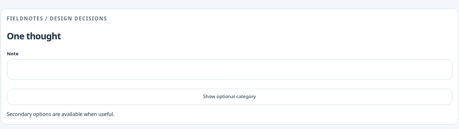 |
| [Craft · refine a real detail](index.html?topic=design-principles&example=craft) | Refine a title, inspect empty-input validation, cancel, and save a better version. [Apple section](https://developer.apple.com/design/human-interface-guidelines/design-principles#Craft) | 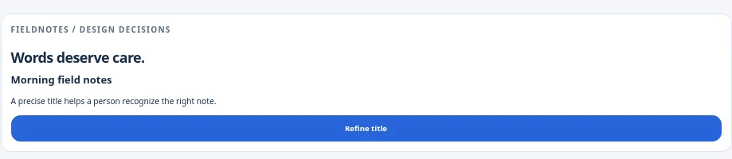 |
| [Delight · a useful finishing moment](index.html?topic=design-principles&example=delight) | Complete a quiet planning task, then reopen it when plans change. [Apple section](https://developer.apple.com/design/human-interface-guidelines/design-principles#Delight) | 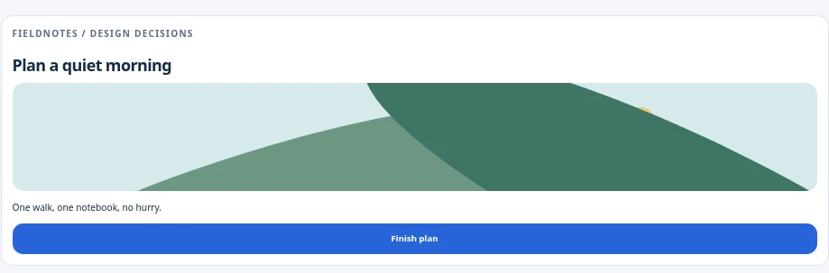 |

## 7. Designing for games

A playable original browser trail game with scoped keys, named controls, settings, pause and local checkpoints. It does not implement Game Center, GameSave, native controllers, haptics, spatial input or full screen.

[Open workshop](index.html?topic=designing-for-games) · [Implementation guide](../../skills/apple-hig/references/workshops/games.md)

| Study | Task and source | Actual rendered picture |
| --- | --- | --- |
| [Teach through playable defaults](index.html?topic=designing-for-games&example=play-first) | Reach camp through play, without a mandatory setup or account flow. [Apple section](https://developer.apple.com/design/human-interface-guidelines/designing-for-games#Jump-into-gameplay) | 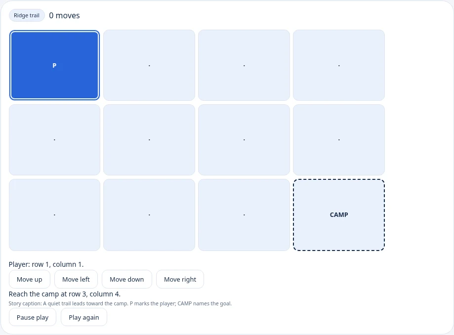 |
| [Adapt the play space](index.html?topic=designing-for-games&example=displays) | Change aspect-ratio model and layout while preserving the player and readable controls. [Apple section](https://developer.apple.com/design/human-interface-guidelines/designing-for-games#Look-stunning-on-every-display) | 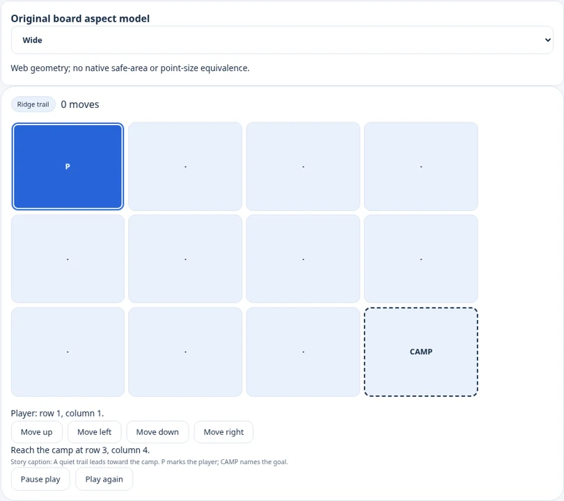 |
| [Inputs with equal access](index.html?topic=designing-for-games&example=controls) | Use named buttons or focus the board and choose Arrow or WASD keys. [Apple section](https://developer.apple.com/design/human-interface-guidelines/designing-for-games#Enable-intuitive-interactions) | 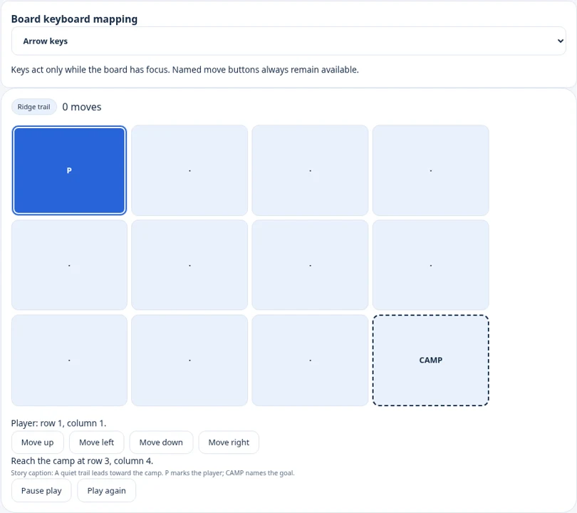 |
| [Perceive and personalize](index.html?topic=designing-for-games&example=accessibility) | Choose stronger cell outlines and story captions; finish using labeled controls. [Apple section](https://developer.apple.com/design/human-interface-guidelines/designing-for-games#Welcome-everyone) | 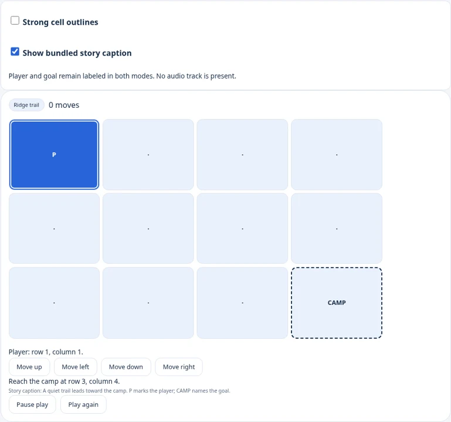 |
| [Pause and recover progress](index.html?topic=designing-for-games&example=continuity) | Store a local checkpoint, play further, pause, and restore the saved position. [Apple section](https://developer.apple.com/design/human-interface-guidelines/designing-for-games#Adopt-Apple-technologies) |  |

## 8. Designing for tvOS

Original illustrated TV-content browser studies. Arrow-key navigation models focus decisions; it does not exercise Siri Remote, the native focus engine, shared sign-in, video playback, or picture-in-picture.

[Open workshop](index.html?topic=designing-for-tvos) · [Implementation guide](../../skills/apple-hig/references/workshops/tvos.md)

| Study | Task and source | Actual rendered picture |
| --- | --- | --- |
| [Focus, open, return](index.html?topic=designing-for-tvos&example=focus) | Navigate a directional grid, open a story, and return to its focused item. [Apple section](https://developer.apple.com/design/human-interface-guidelines/designing-for-tvos#Best-practices) | 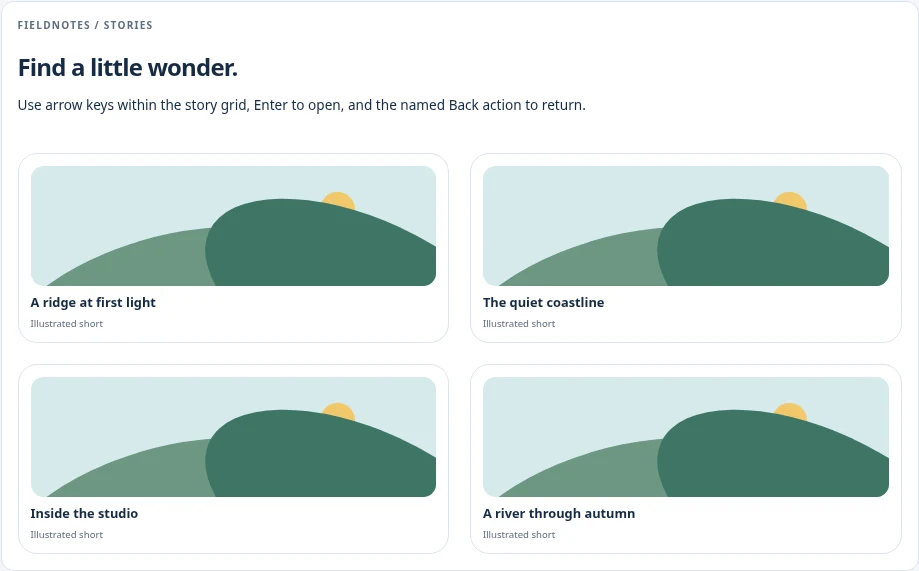 |
| [Readable from a distance](index.html?topic=designing-for-tvos&example=legibility) | Choose a room-reading text treatment while retaining focus and reachable stories. [Apple section](https://developer.apple.com/design/human-interface-guidelines/designing-for-tvos#Best-practices) | 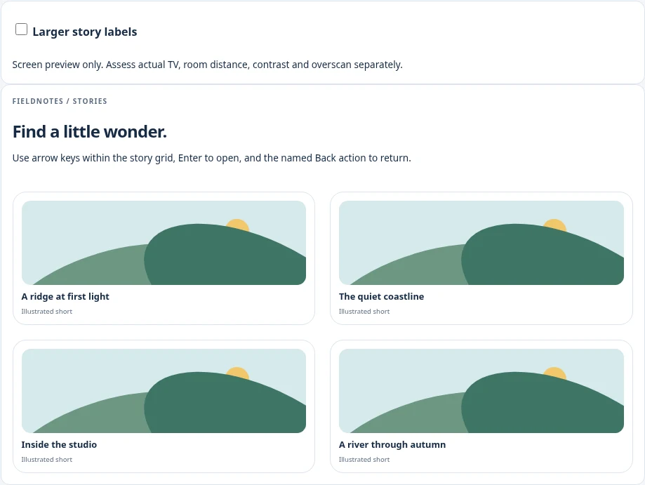 |
| [A shared screen, separate lists](index.html?topic=designing-for-tvos&example=profiles) | Save a story for Alex, switch to Sam, and verify the lists remain independent. [Apple section](https://developer.apple.com/design/human-interface-guidelines/designing-for-tvos#Best-practices) | 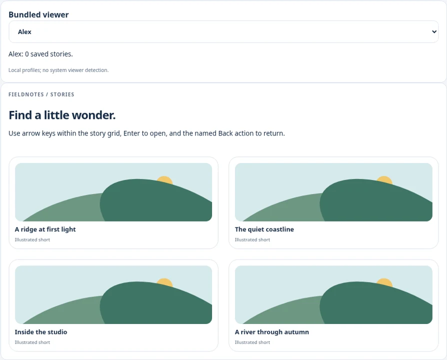 |
| [A concise sign-in handoff model](index.html?topic=designing-for-tvos&example=signin) | Recover from an invalid sample code and complete the bundled local flow. [Apple section](https://developer.apple.com/design/human-interface-guidelines/designing-for-tvos#Best-practices) | 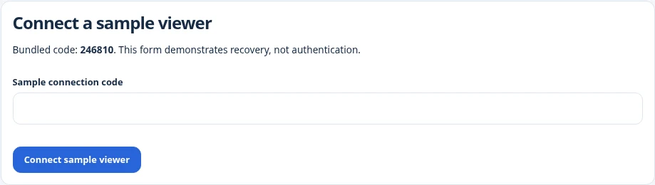 |
| [Continue a story while browsing](index.html?topic=designing-for-tvos&example=playback) | Advance a bundled illustrated story, pause it, and keep its place in a smaller presentation. [Apple section](https://developer.apple.com/design/human-interface-guidelines/designing-for-tvos#Best-practices) | 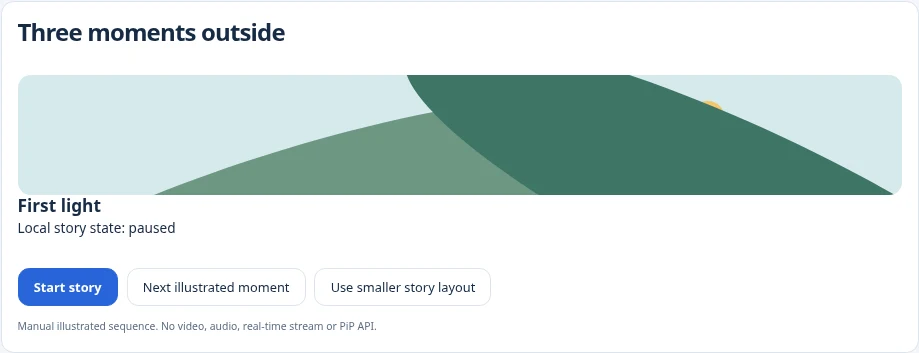 |

## 9. Designing for visionOS

Stationary, original 2D browser illustrations of windowed tasks, immersion choices, objects and sharing state. No spatial tracking, gaze, hand gestures, passthrough, Spatial Audio or SharePlay is implemented.

[Open workshop](index.html?topic=designing-for-visionos) · [Implementation guide](../../skills/apple-hig/references/workshops/visionos.md)

| Study | Task and source | Actual rendered picture |
| --- | --- | --- |
| [A contained, familiar task](index.html?topic=designing-for-visionos&example=contained-task) | Edit a note and open supporting details without leaving the task. [Apple section](https://developer.apple.com/design/human-interface-guidelines/designing-for-visionos#Best-practices) | 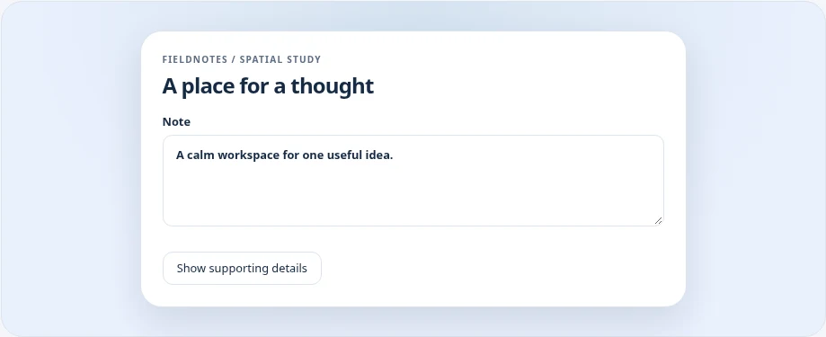 |
| [Choose and leave immersion](index.html?topic=designing-for-visionos&example=immersion) | Enter an illustrated focused context deliberately, then exit with the note preserved. [Apple section](https://developer.apple.com/design/human-interface-guidelines/designing-for-visionos#Best-practices) | 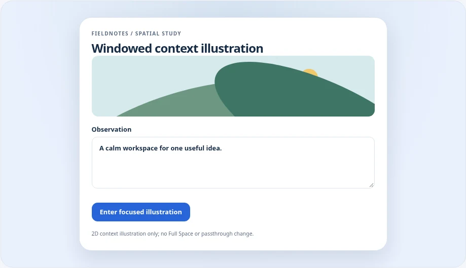 |
| [Select through named alternatives](index.html?topic=designing-for-visionos&example=objects) | Choose an illustrated object and change its orientation with a range or named step action. [Apple section](https://developer.apple.com/design/human-interface-guidelines/designing-for-visionos#Best-practices) | 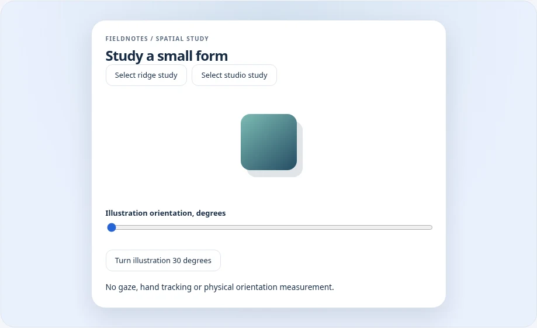 |
| [A stable reference for work](index.html?topic=designing-for-visionos&example=comfort) | Keep an editable task beside a visible stable reference and inspect the illustration’s presentation. [Apple section](https://developer.apple.com/design/human-interface-guidelines/designing-for-visionos#Best-practices) | 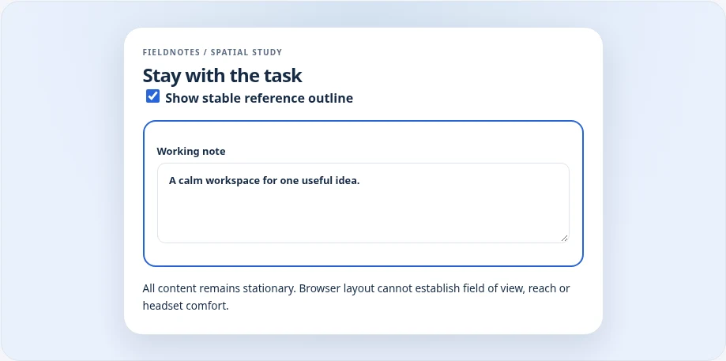 |
| [Shared activity with a clear exit](index.html?topic=designing-for-visionos&example=sharing) | Review a bundled invitation, simulate its acceptance, and leave while preserving the note. [Apple section](https://developer.apple.com/design/human-interface-guidelines/designing-for-visionos#Best-practices) | 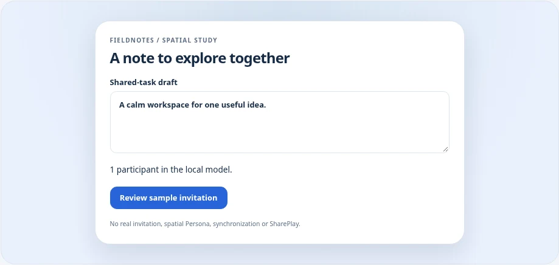 |
