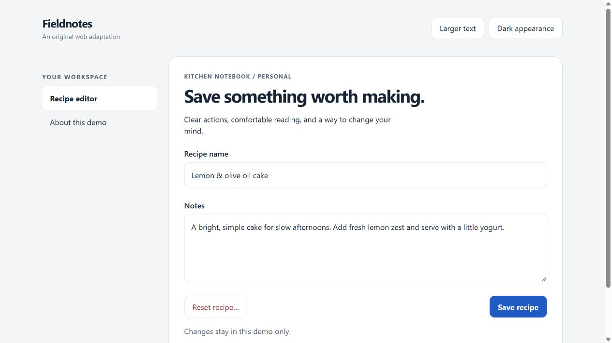
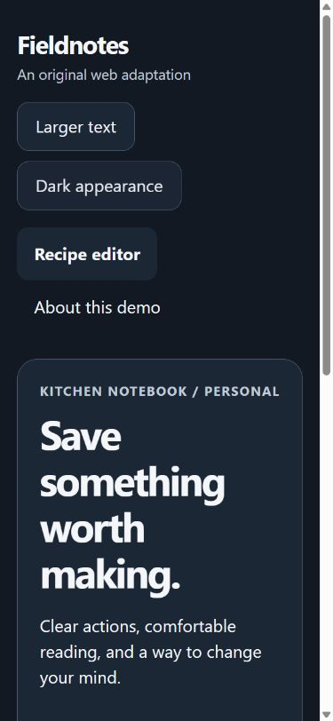

# Web adaptation demo

An original, dependency-free browser example. It demonstrates a responsive editor, named actions, visible keyboard focus, a real modal dialog, cancel behavior, and a live status region. It is not a native Apple screen or an exact HIG geometry specification.

From the repository root:

```sh
python -m http.server 8000 --directory examples/web-adaptation --bind 127.0.0.1
```

Open [the local demo](http://127.0.0.1:8000). Start with keyboard navigation; change the theme and text size, save, and inspect the delete confirmation. Cancel preserves the form. Confirming reset clears only this in-memory demo. Refreshing the page restores the initial example; no data is transmitted or stored.





Manual browser checks covered save feedback, Cancel and Escape preserving content, reset feedback and focus recovery, and a narrow layout with larger text and dark appearance. The narrow test had no horizontal overflow. These are limited browser checks, not a complete assistive-technology audit.

Use your browser's assistive-technology and responsive testing tools for further checks. The demo makes no claim of full accessibility conformance. Its source is a starting point, not a production storage or validation system.
